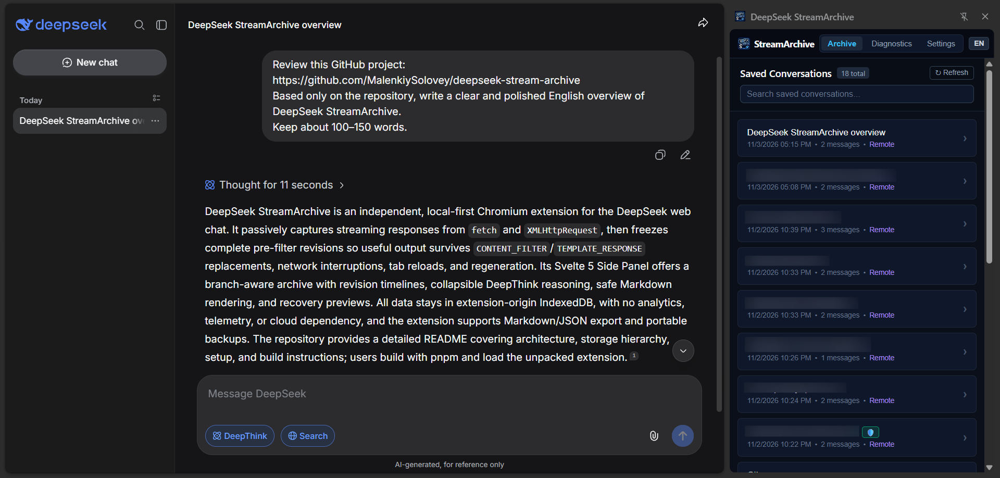
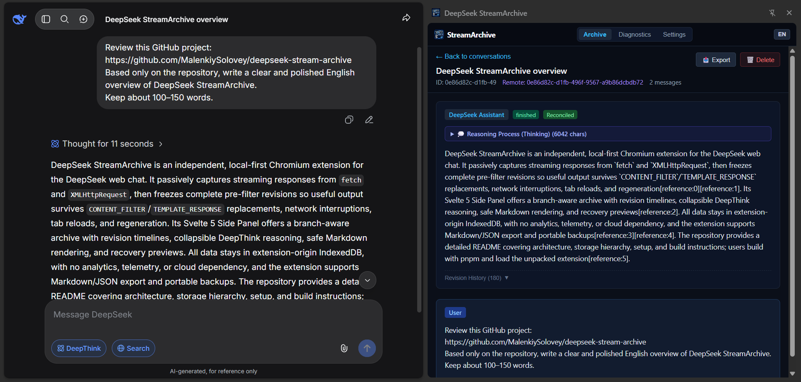
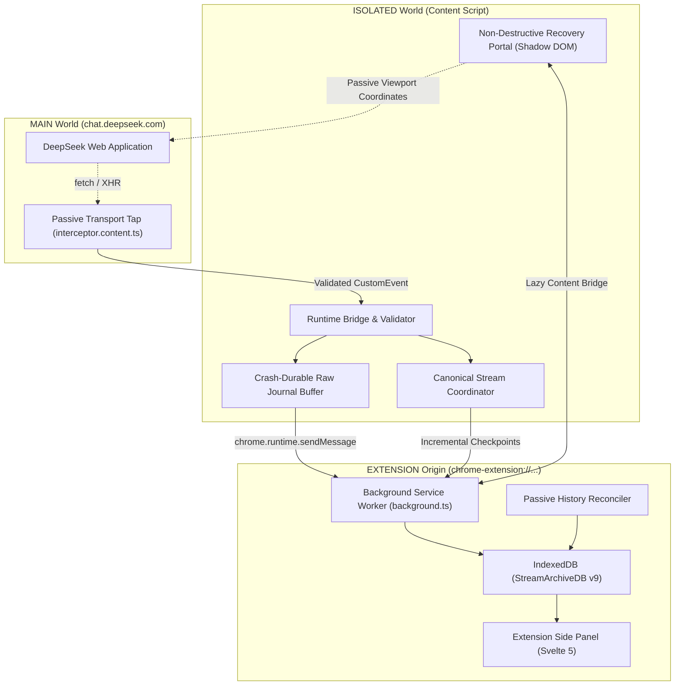

<p align="center">
  
</p>

# DeepSeek StreamArchive

**English** | [Русский](./README_RU.md)

> Local-first Chromium browser extension that records DeepSeek responses while they stream, preserves complete revisions before content filtering or network disconnects, and provides a private, branch-aware archive in the Side Panel.

[](https://github.com/MalenkiySolovey/deepseek-stream-archive/releases)
[](https://github.com/MalenkiySolovey/deepseek-stream-archive/actions/workflows/ci.yml)
[](https://developer.chrome.com/docs/extensions/mv3/)
[](https://wxt.dev/)
[](./LICENSE)
[](./PRIVACY.md)

> [!NOTE]
> **Disclaimer**: DeepSeek StreamArchive is an independent open-source community project. It is not affiliated with, sponsored by, or endorsed by DeepSeek (Hangzhou DeepSeek Artificial Intelligence Co., Ltd.).
>
> **Privacy First**: DeepSeek StreamArchive operates 100% locally in your browser. It does not collect analytics, telemetry, or account credentials. All archives remain on your device in IndexedDB. See [PRIVACY.md](PRIVACY.md) for full details.

---

## Screenshots

<p align="center">
  <a href="./docs/assets/screenshots/01-archive-browser.png"></a>
  <a href="./docs/assets/screenshots/02-conversation-detail.png"></a>
</p>
<p align="center">
  <em>Left: Side Panel Archive Browser listing saved conversations alongside DeepSeek web chat.<br />
  Right: Conversation detail view showing preserved DeepThink reasoning and revision timeline.</em>
</p>

---

## Why StreamArchive?

Modern conversational AI web applications like DeepSeek stream answers token-by-token over Server-Sent Events (SSE). During this process, several common scenarios cause users to permanently lose valuable generated output:

```text
User submits prompt
        ↓
DeepSeek streams 2,000+ tokens of high-quality code or analysis
        ↓
User reads and relies on the answer in real time
        ↓
DeepSeek's post-generation safety filter triggers:
        - status: "CONTENT_FILTER"
        - type: "TEMPLATE_RESPONSE"
        ↓
The DeepSeek web frontend replaces the entire useful message with:
"Sorry, I cannot answer this question. Let's talk about something else."
        ↓
The generated 2,000+ tokens are permanently discarded on both frontend and server.
```

Other frequent loss vectors include:
- Network dropouts or broken HTTP streams midway through generation.
- Accidental browser tab reload or closure while receiving responses.
- DeepSeek frontend virtualized list re-rendering glitches.
- Regenerating a turn without an easy way to retrieve earlier attempts.

**DeepSeek StreamArchive** solves this through passive streaming capture, multi-source redundancy, and durable local archiving directly in your browser.

---

## Key Features

### 1. Passive Zero-Tampering Capture
- **Non-Invasive Observation:** Intercepts outgoing streaming responses from both `fetch()` and `XMLHttpRequest` without mutating living network requests or altering server responses in-flight.
- **WHATWG SSE Framing:** Compliant incremental parser handling multi-byte UTF-8 character boundaries, arbitrary chunk fragmentation, and custom event markers.
- **Decoupled Decoders:** Protocol engine separating generic Server-Sent Events from vendor-specific JSON-patch structures.

### 2. Anti-Recall Invariant & Censorship Recovery
- **Detect-Before-Apply Guard:** Intercepts `CONTENT_FILTER` and `TEMPLATE_RESPONSE` patches before they can overwrite the active state tree.
- **Last-Good State Preservation:** Permanently freezes the complete pre-filtered answer and reasoning chain as an immutable `isLastGood` revision.
- **Durable Recovery Events:** Creates structured `RecoveryEvent` records linking retraction incidents to the preserved pre-filter text.

### 3. Extension-Isolated Storage
- **Chromium MV3 Origin Isolation:** All conversation data, raw batches, and canonical models are stored in IndexedDB hosted strictly inside the extension origin (`chrome-extension://<id>`).
- **Zero Page-Origin Exposure:** The web page context (`chat.deepseek.com`) has zero access to extension storage, tokens, or saved history.

### 4. In-Page Recovery Presentation (Overlay & Optional Inline Mode)
- **Zero DOM Mutation (Overlay Mode):** By default, does not mutate DeepSeek's assistant message nodes, preserving React virtualization and page stability.
- **Closed Shadow DOM Portal:** Renders recovery badges and modal cards in an isolated closed `#shadow-root`, eliminating CSS leaks and preventing page scripts from inspecting recovery state.
- **Optional Inline Chat Recovery:** User-toggleable inline display mode (`overlay` vs `inline`) rendering recovered answers directly inside the message block via closed Shadow DOM, with reversible placeholder style suppression, collapsible DeepThink reasoning, and full preservation of DeepSeek's native action toolbar (`Copy`, `Regenerate`, `Like`, `Dislike`, `Read aloud`, `Share`).
- **Privacy-First Lazy Fetch:** Initial page queries contain zero text snippets; full pre-filter answers and reasoning traces are loaded only upon explicit user click or inline view.
- **Route-Race Isolation:** Monotonic route tokens guarantee that navigating between sessions immediately revokes inline recovery hosts and overlay badges from prior chats.

### 5. Svelte 5 Side Panel Archive Browser
- **Native Side Panel UI:** Clean, responsive interface built with Svelte 5 runes (`$state`, `$derived`, `$props`) accessible right alongside your chats.
- **Branch-Aware Conversation Tree:** Visual branch switcher (`Branch X of Y`) allowing seamless navigation through regenerated answers and edited prompt forks.
- **Collapsible DeepThink Reasoning:** Isolates chain-of-thought (`thinking`) blocks from final response text with expandable containers.
- **Revision Timeline Drawer:** Chronological history of every captured revision with origin tags (`network` vs `history`), timestamps, and length statistics.
- **Recovery Preview Card:** Prominently surfaces the preserved pre-filter text for censored turns with single-click clipboard copying.
- **Safe Markdown Reader:** Token-based Markdown parser rendering headers, lists, quotes, and code blocks safely with **zero `innerHTML`** and **zero `eval`**.
- **Bilingual Interface:** Full localization support for English and Russian (`en` / `ru`).

### 6. Multi-Source Identity & Passive History Reconciliation
- **Passive History Synchronization:** Passively captures `/api/v0/chat/history_messages` responses as you browse, resolving stable server IDs (`message_id`, `chat_session_id`, `parent_id`) without active background polling or token scraping.
- **Stable Identity Merging:** Deterministic merge policy where verified server history upgrades provisional streaming records (`reconciled > provisional`) without erasing pre-filter recovery evidence.
- **Deduplication & Cycle Prevention:** Identical duplicates are safely deduplicated; conflicting server entries are rejected; cyclic parent links are automatically detected and broken.

### 7. Crash-Durable Raw Journal & Replay Engine
- **Durable Raw Evidence:** Captures and batches raw response chunks into an append-only ledger *prior* to protocol decoding.
- **Monotonic Sequence Enforcement:** Strict checkpoint ledger verifying continuous sequence delivery (`seq = lastCommitted + 1`) and rejecting sequence gaps.
- **Immutable Revision Verification:** Rejects conflicting payload overwrites while guaranteeing idempotent re-commit of identical data.
- **Offline Deterministic Replay:** Reconstructs canonical conversation trees from raw recorded batches without requiring an internet connection.

### 8. Export, Portable Backup & Atomic Restore
- **Human Conversation Export:** Exports individual threads to clean Markdown (`.md`) or structured canonical JSON (`.json`) with branch selection, reasoning inclusion, and pre-filter recovery provenance.
- **Portable Full Backup:** Creates compressed, versioned full-archive backups (`.streamarchive.jsonl.gz`) via native `CompressionStream('gzip')` without external libraries or `chrome.downloads` permission.
- **Safe Atomic Restore:** Fully validates imported backup archives with streaming decompression bomb protection (250 MiB ceiling), field schema validation, and pre-commit referential integrity checks.
- **Two Restore Modes:** Supports **Replace Archive** (atomic single-transaction replacement across all stores with 100% rollback guarantee) and **Safe Merge Archive** (strict primary-key union with conflict and identity collision prevention).

### 9. Storage Observability, Retention & Safe Deletion
- **Native Storage Observability:** Monitors browser storage usage and quota via `navigator.storage.estimate()` alongside exact entity counts directly from IndexedDB.
- **Durable Persistence Request:** Protects local archive data from browser eviction via one-click `navigator.storage.persist()`.
- **Configurable Raw Retention:** Automatic age-pruning for raw HTTP transport streams (`forever` [default], 30, 90, 180 days). Canonical conversation history is **never** deleted automatically.
- **Protected Evidence Shield:** Pure policy engine indefinitely shields in-flight streams, pre-filter recovery provenance (`status === 'filtered'`, `RecoveryEvent`, `isLastGood`), and forensic capture anomalies.
- **Safe Single-Conversation Deletion:** 2-step preview modal with active stream guards, concurrency stale barriers (`updatedAt`), and atomic multi-store rollback (`tx.abort()`).
- **Archive Maintenance & Purge:** Fast maintenance actions to clean up expired raw streams, purge all raw evidence while preserving conversations, or reset the local archive.

### 10. Branch-Aware Context Continuity & Explicit Delivery
- **Topological Lineage Derivation:** Pure topological resolver identifying the active branch path, cleanly isolating alternate sibling regenerations (`wrong_branch`) and stripping non-logical turns.
- **Uniform Eligibility:** Filtered responses, network interruptions, manual stops, and template replacements participate equally under uniform structural eligibility rules.
- **Budget Clamping & Safe Slicing:** Limits inclusion to 4 blocks (12,000 text chars, 6,000 thinking chars) with surrogate-safe UTF-16 slicing and visible omission disclosures.
- **Transparent Side Panel Preview:** Dedicated modal with payload metrics, cause badges, collapsible exclusion audit, and single-click copy action.
- **Explicit Context Delivery:** Optional prompt augmentation delivering recovered context into subsequent DeepSeek queries without manual copy-pasting.
- **Delivery Modes (`manual_next` vs `automatic`):** Default `manual_next` mode requires single-use arming via Side Panel ("Use continuity for next message") with automatic one-shot disarming; `automatic` mode continuously augments the next eligible turn on the active branch.
- **Strict Fail-Open Safety:** Sends original request completely untouched if endpoint, method, JSON body, parent ID, session ID, or TTL cannot be proven 100% safe.
- **Retry Idempotency & Delimiter Framing:** Marker boundaries prevent duplicate prompt augmentation during DeepSeek client network retries.
- **Durable Operational Ledger:** Stores receipts (`dispatched` -> `response_observed` -> `bridged` | `failed`), breaking infinite re-injection loops while remaining excluded from Portable Backup.
- **Clean History Reconciliation:** Parses delimiter markers from server history, rendering clean user-authored prompts with the `🔄 Context Continuity attached` badge.

---

## How It Works

StreamArchive operates across three isolated browser execution realms:



---

## Installation

### For Users (Download Release)

1. Download the latest `deepseek-stream-archive-0.1.0-chrome.zip` from [GitHub Releases](https://github.com/MalenkiySolovey/deepseek-stream-archive/releases).
2. Unzip the downloaded file into a folder of your choice.
3. Open Google Chrome or any Chromium browser and navigate to `chrome://extensions/`.
4. Turn ON **Developer mode** using the toggle switch in the top-right corner.
5. Click the **Load unpacked** button in the top-left corner.
6. Select the unzipped folder containing the extension files.
7. Open [DeepSeek Chat](https://chat.deepseek.com/) and click the **Side Panel** icon in Chrome's toolbar to open DeepSeek StreamArchive.

### For Developers (Build from Source)

#### Prerequisites
- [Node.js](https://nodejs.org/) >= 20.0.0
- [pnpm](https://pnpm.io/) >= 9.0.0

#### Build Steps
1. Clone the repository:
   ```bash
   git clone https://github.com/MalenkiySolovey/deepseek-stream-archive.git
   cd deepseek-stream-archive
   ```

2. Install dependencies:
   ```bash
   pnpm install --frozen-lockfile
   ```

3. Build the production extension:
   ```bash
   pnpm run build
   ```
   The compiled extension will be placed in `.output/chrome-mv3`.

4. Follow steps 3–7 from the user instructions above, selecting `.output/chrome-mv3` when prompted.

---

## Recovery Modes

StreamArchive provides two presentation modes for accessing pre-filter and interrupted text, configurable in Settings:

| Feature | Overlay Mode (Default) | Inline Mode (Optional) |
|---|---|---|
| **Mount Location** | Closed Shadow DOM floating badge attached to message bounds | Closed Shadow DOM host inside the assistant message block |
| **DOM Impact** | Zero DOM mutation of native message elements | Reversibly hides native canned refusal text |
| **Native Toolbar** | 100% native DeepSeek action toolbar preserved | 100% native DeepSeek action toolbar preserved |
| **DeepThink View** | Available inside modal card and Side Panel | Rendered directly inline with collapsible toggle |
| **Performance** | Zero layout shifts; virtualized scrolling unaffected | Minimal layout shift; virtualized scrolling unaffected |

---

## Privacy & Security

| Invariant | Guarantee |
|---|---|
| **Zero External Network Requests** | The extension never communicates with any third-party server, analytics platform, or cloud storage. |
| **Zero Active API Polling** | The service worker never issues proactive requests to DeepSeek APIs. History is ingested solely via natural browser navigation. |
| **Zero Credential Inspection** | Never reads `localStorage.userToken`, session cookies, or `Authorization: Bearer` headers. |
| **Zero Prompt Body Inspection** | Outgoing user prompt payloads remain uninspected. |
| **Safe Rendering** | User and model outputs are parsed via tokenization; `innerHTML`, `{@html}`, and `eval` are strictly forbidden. |
| **Storage Origin Lockdown** | IndexedDB is opened solely under `chrome-extension://<id>`, inaccessible to web pages. |
| **Context Continuity Transparency** | Context Continuity is OFF by default. When explicitly enabled, only locally stored pre-filter or interrupted text is injected into subsequent user prompts, with full boundary disclosure and single-use disarm safeguards. |

See [PRIVACY.md](./PRIVACY.md) and [SECURITY.md](./SECURITY.md) for full architectural disclosures.

---

## Limitations

- **DeepSeek Web Only:** StreamArchive operates strictly on `https://chat.deepseek.com/*`. Third-party DeepSeek API clients or other AI services are intentionally unsupported.
- **Pre-Transmission Content:** Content that is filtered on the server before reaching the browser network layer cannot be captured.
- **Platform Scope:** Version 0.1.0 targets Chromium-based browsers (Chrome, Edge, Brave, etc.) supporting Manifest V3 Side Panel API (Chrome 114+). Firefox is not supported in this release.

---

## Development & Testing

StreamArchive maintains an automated test suite covering chunk boundary fuzzing, protocol decoding, censorship interception, database migrations, and a headless Chromium MV3 compatibility harness:

```bash
# Run unit and integration tests (87 test files, 591 tests)
pnpm run test

# Run TypeScript typecheck (0 errors)
pnpm run typecheck

# Build unpacked Chrome MV3 extension (.output/chrome-mv3)
pnpm run build

# Run Playwright Chromium MV3 browser compatibility harness (19 specs, 25 tests)
pnpm run test:e2e

# Package extension distribution archive (.output/deepseek-stream-archive-0.1.0-chrome.zip)
pnpm run zip

# Run release store readiness and security audit
pnpm run release:audit

# Start WXT development server with live-reloading
pnpm run dev
```

---

## Documentation

- [Architecture Overview](./docs/ARCHITECTURE.md)
- [Canonical Data Model](./docs/CANONICAL_MODEL.md)
- [DeepSeek Protocol Specification](./docs/DEEPSEEK_PROTOCOL.md)
- [Privacy & Security Specification](./docs/PRIVACY_SECURITY.md)
- [Context Continuity Specification](./docs/CONTEXT_CONTINUITY.md)
- [Export & Backup Format v1](./docs/BACKUP_FORMAT_V1.md)
- [Testing Strategy](./docs/TESTING_STRATEGY.md)
- [Architecture Decision Records (ADRs)](./docs/ADR/)

---

## Acknowledgements

- **[EdgeTypE/better-deepseek](https://github.com/EdgeTypE/better-deepseek)** (MIT License):
  Adapted heuristic message ID search logic (`src/adapters/deepseek/protocol/message-id.ts`) for recursive identification of DeepSeek message identifiers in streaming payloads.

---

## License

This project is licensed under the [MIT License](./LICENSE).
