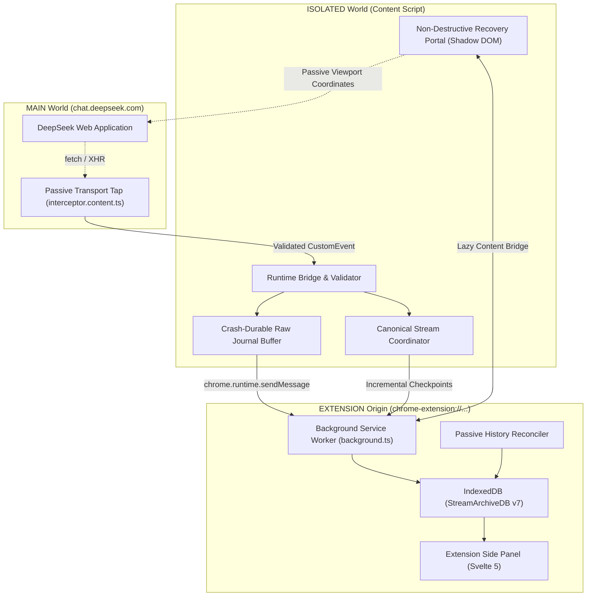

# DeepSeek StreamArchive

**English** | [Русский](./README_RU.md)

> Local-first Chromium browser extension that records DeepSeek responses while they stream, preserves complete revisions before content filtering or network disconnects, and provides a private, branch-aware archive in the Side Panel.


---

## Overview

Modern conversational AI web applications like DeepSeek stream answers token-by-token over Server-Sent Events (SSE). During this process, several common scenarios cause users to permanently lose valuable generated output:

```text
User submits prompt
        ↓
DeepSeek streams 2,000+ tokens of high-quality code or analysis
        ↓
User reads and relies on the answer in real time
        ↓
DeepSeek's post-generation safety filter triggers:
        - status: "CONTENT_FILTER"
        - type: "TEMPLATE_RESPONSE"
        ↓
The DeepSeek web frontend replaces the entire useful message with:
"Sorry, I cannot answer this question. Let's talk about something else."
        ↓
The generated 2,000+ tokens are permanently discarded on both frontend and server.
```

Other frequent loss vectors include:
- Network dropouts / broken HTTP streams midway through generation.
- Accidental browser tab reload or closure during streaming.
- DeepSeek frontend virtualized list re-rendering glitches.
- Regenerating a turn without an easy way to compare or retrieve the prior attempt.

**DeepSeek StreamArchive** solves this comprehensively through passive streaming capture, multi-source redundancy, and durable local archiving directly in your browser.

---

## Key Features

### 1. Passive Zero-Tampering Capture
- **Non-Invasive Observation:** Intercepts outgoing streaming responses from both `fetch()` and `XMLHttpRequest` without mutating living network requests or altering server responses in-flight.
- **WHATWG SSE Framing:** Compliant incremental parser handling multi-byte UTF-8 character boundaries, arbitrary chunk fragmentation, and custom event markers.
- **Decoupled Decoders:** Robust protocol engine separating generic Server-Sent Events from vendor-specific JSON-patch structures.

### 2. Anti-Recall Invariant & Censorship Recovery
- **Detect-Before-Apply Guard:** Intercepts `CONTENT_FILTER` and `TEMPLATE_RESPONSE` patches before they can overwrite the active state tree.
- **Last-Good State Preservation:** Permanently freezes the complete pre-filtered answer and reasoning chain as an immutable `isLastGood` revision.
- **Durable Recovery Events:** Creates structured `RecoveryEvent` records linking censorship incidents to the preserved pre-filter text.

### 3. Extension-Isolated Storage
- **Chromium MV3 Origin Isolation:** All conversation data, raw batches, and canonical models are stored in an IndexedDB database hosted strictly inside the extension origin (`chrome-extension://<id>`).
- **Zero Page-Origin Exposure:** The web page context (`chat.deepseek.com`) has zero access to extension storage, tokens, or saved history.

### 4. Non-Destructive In-Page Recovery Overlay
- **Zero DOM Mutation:** Does not mutate or append elements to DeepSeek's assistant message nodes, preserving React virtualization and page stability.
- **Closed Shadow DOM Portal:** Renders recovery badges and modal cards in an isolated closed `#shadow-root`, eliminating CSS leaks and preventing page scripts from inspecting recovery state.
- **Privacy-First Lazy Fetch:** Initial page queries contain zero text snippets; full pre-filter answers and reasoning traces are loaded only upon explicit user click.
- **Route-Race Isolation:** Monotonic route tokens guarantee that navigating between sessions never displays stale recovery badges from prior chats.

### 5. Svelte 5 Side Panel Archive Browser
- **Native Side Panel UI:** Clean, responsive interface built with Svelte 5 runes (`$state`, `$derived`, `$props`) accessible right alongside your chats.
- **Branch-Aware Conversation Tree:** Visual branch switcher (`Branch X of Y`) allowing seamless navigation through regenerated answers and edited prompt forks.
- **Collapsible DeepThink Reasoning:** Isolates chain-of-thought (`thinking`) blocks from final response text with expandable containers.
- **Revision Timeline Drawer:** Chronological history of every captured revision with origin tags (`network` vs `history`), timestamps, and length statistics.
- **Recovery Preview Card:** Prominently surfaces the preserved pre-filter text for censored turns with single-click clipboard copying.
- **Safe Markdown Reader:** Token-based Markdown parser rendering headers, lists, quotes, and code blocks safely with **zero `innerHTML`** and **zero `eval`**.
- **Bilingual Interface:** Full localization support for English and Russian (`en` / `ru`).

### 6. Multi-Source Identity & Passive History Reconciliation
- **Passive History Synchronization:** Passively captures `/api/v0/chat/history_messages` responses as you browse, resolving stable server IDs (`message_id`, `chat_session_id`, `parent_id`) without active background polling or token scraping.
- **Stable Identity Merging:** Deterministic merge policy where verified server history upgrades provisional streaming records (`reconciled > provisional`) without erasing pre-filter recovery evidence.
- **Deduplication & Cycle Prevention:** Identical duplicates are safely deduplicated; conflicting server entries are rejected; cyclic parent links are automatically detected and broken.

### 7. Crash-Durable Raw Journal & Replay Engine
- **Durable Raw Evidence:** Captures and batches raw response chunks into an append-only ledger *prior* to protocol decoding.
- **Monotonic Sequence Enforcement:** Strict checkpoint ledger verifying continuous sequence delivery (`seq = lastCommitted + 1`) and rejecting sequence gaps.
- **Immutable Revision Verification:** Rejects conflicting payload overwrites while guaranteeing idempotent re-commit of identical data.
- **Offline Deterministic Replay:** Reconstructs canonical conversation trees from raw recorded batches without requiring an internet connection.

### 8. 100% Local & Private
- **Zero External Calls:** No analytics, no telemetry, no cloud accounts, and no third-party servers. All data stays strictly on your local machine.
- **Minimal Manifest Permissions:** Operates under strict Chromium Manifest V3 permissions: only `storage` and `sidePanel`.

---

## Architecture

StreamArchive operates across three isolated browser execution realms:



---

## Storage Hierarchy

```text
IndexedDB: StreamArchiveDB (Version 7)
├── Raw Journal (Evidence Layer)
│   ├── raw_streams: Stream session metadata, transport type, integrity flags
│   └── raw_stream_batches: Persisted chunk batches with monotonic sequencing
├── Checkpoint Ledger
│   └── canonical_checkpoints: Stream checkpoint progression and sequence gap detection
├── History Staging Store
│   ├── history_staging_manifests: Staging manifests tracking completeness barriers
│   └── history_staging: Multi-batch incremental history staging chunks
└── Canonical Domain Entities
    ├── conversations: Logical chat threads with remote session mapping
    ├── messages: Tree nodes preserving parent linkages, role, and identity state
    ├── revisions: Immutable text and thinking snapshots with content fingerprints
    └── recovery_events: Structured censorship and recovery audit markers
```

---

## Getting Started

### Prerequisites
- [Node.js](https://nodejs.org/) >= 20.0.0
- [pnpm](https://pnpm.io/) >= 9.0.0

### Installation & Build

1. Clone the repository:
   ```bash
   git clone https://github.com/MalenkiySolovey/deepseek-stream-archive.git
   cd deepseek-stream-archive
   ```

2. Install dependencies:
   ```bash
   pnpm install
   ```

3. Build the production extension:
   ```bash
   pnpm run build
   ```
   The compiled extension will be placed in `.output/chrome-mv3`.

### Loading into Chrome / Chromium

1. Open Chrome and navigate to `chrome://extensions/`.
2. Enable **Developer mode** via the toggle in the top-right corner.
3. Click **Load unpacked** and select the `.output/chrome-mv3` directory.
4. Navigate to [DeepSeek Chat](https://chat.deepseek.com/).
5. Open the **Side Panel** in Chrome and select **DeepSeek StreamArchive** from the dropdown.

For manual live testing instructions on `chat.deepseek.com`, see the [Live Acceptance Testing Guide](./docs/LIVE_ACCEPTANCE.md).

---

## Development & Testing

StreamArchive maintains an exhaustive automated test suite covering chunk boundary fuzzing, protocol decoding, censorship interception, database migrations, and concurrency:

```bash
# Run the full Vitest suite (52 test files, 348 tests)
pnpm run test

# Run TypeScript typecheck
pnpm run typecheck

# Start WXT development server with live-reloading
pnpm run dev
```

---

## Security & Privacy Invariants

| Invariant | Guarantee |
|---|---|
| **Zero External Network Requests** | The extension never communicates with any third-party server, analytics platform, or cloud storage. |
| **Zero Active API Polling** | The service worker never issues proactive requests to DeepSeek APIs. History is ingested solely via natural browser navigation. |
| **Zero Credential Inspection** | Never reads `localStorage.userToken`, session cookies, or `Authorization: Bearer` headers. |
| **Zero Prompt Body Inspection** | Outgoing user prompt payloads remain uninspected. |
| **Safe Rendering** | User and model outputs are parsed via tokenization; `innerHTML`, `{@html}`, and `eval` are strictly forbidden. |
| **Storage Origin Lockdown** | IndexedDB is opened solely under `chrome-extension://<id>`, inaccessible to web pages. |

---

## Acknowledgements & Third-Party Code

- **[EdgeTypE/better-deepseek](https://github.com/EdgeTypE/better-deepseek)** (MIT License):
  Adapted heuristic message ID search logic (`src/adapters/deepseek/protocol/message-id.ts`) for recursive identification of DeepSeek message identifiers in streaming payloads.

---

## License

This project is licensed under the [MIT License](./LICENSE).
