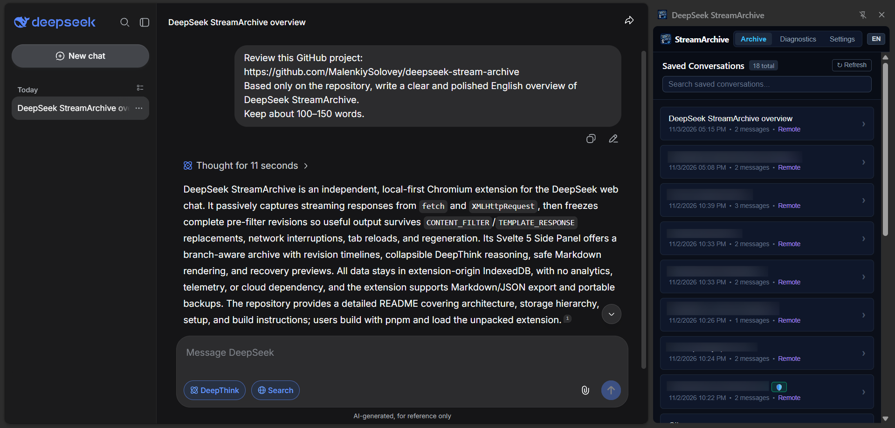
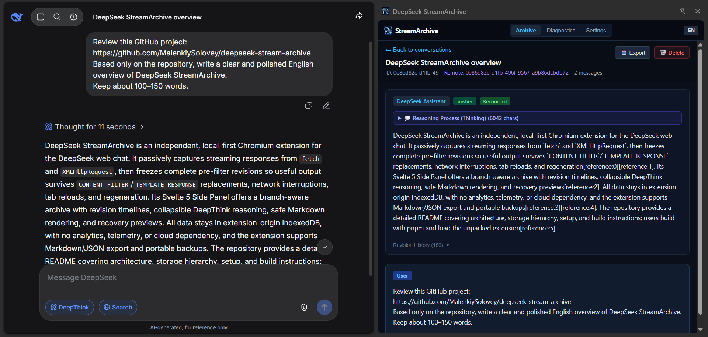

<p align="center">
  
</p>

# DeepSeek StreamArchive

[English](./README.md) | **Русский**

> Локальное расширение для браузеров на базе Chromium, которое перехватывает и сохраняет ответы DeepSeek в реальном времени во время генерации, защищает от цензуры (`CONTENT_FILTER`) и обрывов сети, а также предоставляет удобный архив с поддержкой веток диалога в боковой панели (Side Panel).

[](https://github.com/MalenkiySolovey/deepseek-stream-archive/releases)
[](https://github.com/MalenkiySolovey/deepseek-stream-archive/actions/workflows/ci.yml)
[](https://developer.chrome.com/docs/extensions/mv3/)
[](https://wxt.dev/)
[](./LICENSE)
[](./PRIVACY.md)

> [!NOTE]
> **Отказ от ответственности**: DeepSeek StreamArchive — независимый проект с открытым исходным кодом. Расширение не связано с компанией DeepSeek (Hangzhou DeepSeek Artificial Intelligence Co., Ltd.), не спонсируется и не поддерживается ею.
>
> **Приватность превыше всего**: DeepSeek StreamArchive работает на 100% локально в вашем браузере. Мы не собираем аналитику, телеметрию или учетные данные пользователей. Вся переписка хранится исключительно на вашем устройстве в IndexedDB. Подробности см. в [PRIVACY.md](PRIVACY.md).

---

## Скриншоты

<p align="center">
  <a href="./docs/assets/screenshots/01-archive-browser.png"></a>
  <a href="./docs/assets/screenshots/02-conversation-detail.png"></a>
</p>
<p align="center">
  <em>Слева: боковая панель StreamArchive со списком сохранённых диалогов рядом с чатом DeepSeek.<br />
  Справа: детальный просмотр диалога с рассуждениями DeepThink и историей ревизий.</em>
</p>

---

## Зачем нужен StreamArchive?

Современные веб-интерфейсы языковых моделей, такие как DeepSeek, передают сгенерированный текст токен за токеном по протоколу Server-Sent Events (SSE). В процессе генерации пользователи нередко сталкиваются с безвозвратной потерей ценных результатов:

```text
Пользователь отправляет запрос
        ↓
DeepSeek генерирует 2000+ токенов качественного кода или детального анализа
        ↓
Пользователь видит ответ в реальном времени и начинает его читать
        ↓
В конце срабатывает серверный фильтр безопасности:
        - status: "CONTENT_FILTER"
        - type: "TEMPLATE_RESPONSE"
        ↓
Веб-интерфейс DeepSeek удаляет весь полезный сгенерированный текст и подменяет его заглушкой:
"Извините, я не могу ответить на этот вопрос. Давайте поговорим о чём-нибудь другом."
        ↓
Сгенерированные 2000+ токенов удаляются навсегда как из памяти страницы, так и из истории на сервере.
```

Другие частые причины потери данных:
- Обрыв соединения или падение HTTP-потока в процессе ответа.
- Случайная перезагрузка или закрытие вкладки браузера во время генерации.
- Ошибки рендеринга виртуализированных списков на стороне интерфейса DeepSeek.
- Регенерация ответа, которая затирает предыдущую версию без возможности вернуться к ней.

**DeepSeek StreamArchive** решает эти проблемы за счёт пассивного перехвата потоковых данных, многоуровневой избыточности и надёжного локального архивирования прямо в браузере.

---

## Ключевые возможности

### 1. Пассивный перехват без вмешательства в трафик
- **Неинвазивное наблюдение:** Клонирует и перехватывает исходящие потоковые ответы через `fetch()` и `XMLHttpRequest`, не задерживая оригинальный `Response` и не вмешиваясь в сетевой поток страницы.
- **Поддержка спецификации WHATWG SSE:** Корректная обработка произвольных границ чанков, многобайтовых символов UTF-8 и произвольной фрагментации потока.
- **Разделение уровней:** Транспортный декодер SSE полностью изолирован от прикладных протокольных JSON-патчей DeepSeek.

### 2. Защита от цензуры и отзыва ответов (Anti-Recall)
- **Барьер «Detect-Before-Apply»:** Перехватывает системные патчи `CONTENT_FILTER` и `TEMPLATE_RESPONSE` до того, как они успевают изменить внутреннее дерево состояния.
- **Сохранение лучшей версии (Last-Good):** Замораживает полный сгенерированный текст ответа и цепочку рассуждений в виде неизменяемой ревизии `isLastGood`.
- **События восстановления:** Сохраняет структурированные записи `RecoveryEvent`, связывающие факт цензуры с сохранённым исходным текстом.

### 3. Изолированное хранилище расширения
- **Изоляция origin Chromium MV3:** Все диалоги, сырые журналы и канонические модели сохраняются в IndexedDB, работающей исключительно в изолированном контексте расширения (`chrome-extension://<id>`).
- **Нулевой доступ со страницы:** Контекст веб-страницы (`chat.deepseek.com`) не имеет доступа к базе данных расширения, токенам и сохранённой переписке.

### 4. Отображение восстановленных ответов (Оверлей и опциональный режим Inline)
- **Нулевая модификация DOM (Режим оверлея):** По умолчанию не модифицирует элементы сообщений DeepSeek, сохраняя стабильность виртуализации React и верстки страницы.
- **Изолированный Closed Shadow DOM:** Отображает бейджи и карточки восстановления в закрытом `#shadow-root`, исключая утечки CSS и предотвращая чтение состояния скриптами страницы.
- **Опциональное отображение прямо в чате (Inline Mode):** Настраиваемый режим отображения (`overlay` или `inline`), встраивающий спасённый ответ прямо в блок сообщения ассистента через closed Shadow DOM с обратимым скрытием серверной заглушки, сворачиваемым блоком DeepThink и полным сохранением нативной панели кнопок DeepSeek (`Copy`, `Regenerate`, `Like`, `Dislike`, `Read aloud`, `Share`).
- **Конфиденциальная ленивая загрузка:** Первичные сводки не содержат фрагментов текста; полный восстановленный ответ загружается по защищенному IPC-мосту только по прямому клику пользователя или при inline-просмотре.
- **Изоляция маршрутов (Route Epoch Fencing):** Монотонные токены навигации гарантируют, что inline-блоки и бейджи предыдущей сессии мгновенно удаляются при переходе в другой диалог.

### 5. Архив в боковой панели (Svelte 5 Side Panel)
- **Нативный интерфейс Side Panel:** Быстрый и лёгкий интерфейс на базе Svelte 5 runes (`$state`, `$derived`, `$props`), расположенный рядом с открытым чатом.
- **Дерево диалога с поддержкой веток:** Переключатель веток (`Ветка X из Y`) для просмотра регенераций ответов и альтернативных веток после редактирования запросов.
- **Сворачиваемый блок DeepThink:** Отделяет цепочку рассуждений (`thinking`) от основного текста ответа, предотвращая визуальное загромождение.
- **История ревизий (Timeline Drawer):** Список всех зафиксированных версий ответа с индикацией источника (`network` или `history`), временными метками и отпечатками контента.
- **Карточка Recovery Preview:** Отображает исходный текст, сохранённый до вмешательства цензуры, с кнопкой мгновенного копирования в буфер обмена.
- **Безопасный рендеринг Markdown:** Токенизированный парсер заголовков, списков, цитат и блоков кода без использования `innerHTML` и `eval`.
- **Двуязычный интерфейс:** Полная поддержка английского и русского языков (`en` / `ru`).

### 6. Пассивная синхронизация с историей DeepSeek
- **Синхронизация без опроса:** Перехватывает ответы `/api/v0/chat/history_messages` при естественной навигации пользователя, связывая серверные идентификаторы (`message_id`, `chat_session_id`, `parent_id`) без фоновых запросов и без извлечения токенов авторизации.
- **Надёжное слияние идентичностей:** Серверные данные обновляют предварительные стриминговые записи по принципу `reconciled > provisional`, никогда не стирая доказательства цензуры.
- **Дедупликация и защита от циклов:** Идентичные дубликаты дедуплицируются, конфликтующие записи сервера отклоняются, а циклические связи родителей автоматически разрываются.

### 7. Надёжный журнал сырых данных (Raw Journal) и Replay
- **Хранение сырых байтов:** Фиксирует исходные чанки ответа в append-only журнал до их парсинга протокольным адаптером.
- **Монотонный контроль последовательности:** Ledger-реестр чекпоинтов отслеживает непрерывность передачи (`seq = lastCommitted + 1`) и отклоняет пропуски.
- **Защита от конфликтов в ревизиях:** Отклоняет попытки перезаписи ревизий другими данными при сохранении идемпотентности повторных запросов.
- **Детерминированное офлайн-воспроизведение:** Позволяет реконструировать каноническое дерево сообщений из сырых сохранённых чанков без подключения к сети.

### 8. Экспорт, резервное копирование и атомарное восстановление
- **Экспорт диалогов для человека:** Выгрузка отдельных веток в чистый Markdown (`.md`) или канонический JSON (`.json`) с выбором активной ветки, сохранением рассуждений DeepThink и пометок о снятии цензуры.
- **Портативный бэкап всего архива:** Создание сжатого версионированного файла резервной копии (`.streamarchive.jsonl.gz`) через нативный `CompressionStream('gzip')` без сторонних библиотек и без разрешения `chrome.downloads`.
- **Безопасное атомарное восстановление:** Потоковая проверка архива с защитой от gzip-бомб (порог 250 МБ), валидация схем полей и предварительная проверка связности графа (ацикличность дерева, изоляция веток).
- **Два режима восстановления:** Поддержка режимов **Замена архива** (Replace Archive — атомарная замена в 1 транзакции по всем таблицам со 100% гарантией отката) и **Безопасное объединение** (Merge Archive — объединение по первичным ключам с защитой от конфликтов и коллизий сессий).

### 9. Мониторинг хранилища, очистка и безопасное удаление
- **Наблюдаемость хранилища:** Измерение использования диска и квоты через `navigator.storage.estimate()` и точный подсчёт записей из IndexedDB.
- **Защита от вытеснения:** Запрос постоянного хранения (`navigator.storage.persist()`) в один клик для защиты архива при нехватке места на диске.
- **Настраиваемое хранение сырых данных:** Автоматическая очистка сырых HTTP-потоков по возрасту (`forever` [по умолчанию], 30, 90, 180 дней). Каноническая история диалогов **никогда** не удаляется автоматически.
- **Щит защищённых свидетельств (Protected Evidence Shield):** Активные потоки, спасённые версии ответов (`status === 'filtered'`, `RecoveryEvent`, `isLastGood`) и потоки с аномалиями защищены от удаления бессрочно.
- **Безопасное удаление отдельного диалога:** 2-этапное подтверждение с предпросмотром, барьером актуальности (`updatedAt`), проверкой активных потоков и атомарным каскадным откатом (`tx.abort()`).
- **Сервисные действия в настройках:** Быстрая ручная очистка устаревших потоков, удаление только сырых свидетельств с сохранением всех диалогов, либо полная очистка локального архива.

### 10. Непрерывность контекста с учётом веток и явная доставка
- **Топологическое определение активной ветки:** Чистый алгоритм обхода графа сообщений, определяющий активную ветку диалога, надёжно изолирующий параллельные регенерации (`wrong_branch`) и отсекающий технические попытки.
- **Инвариант форензик-метаданных:** Спасённые от цензуры ответы, сетевые обрывы, ручные остановки генерации и шаблонные заглушки участвуют на равных условиях по строгим структурным правилам пригодности.
- **Лимиты объёма и безопасное усечение UTF-16:** Ограничение до 4 блоков (12 000 символов ответа, 6 000 символов рассуждений) с защитой суррогатных пар Unicode и явным раскрытием пропусков.
- **Прозрачный предпросмотр в боковой панели:** Модальное окно с детальной статистикой, метками причин спасения, аудитом исключений и копированием в буфер обмена в один клик.
- **Явная доставка контекста:** Опциональное дополнение промпта спасённым контекстом в следующих репликах без ручного копирования.
- **Режимы доставки (`manual_next` и `automatic`):** Режим по умолчанию `manual_next` требует явного разового взвода в боковой панели («Использовать контекст для следующего сообщения») с автоматическим снятием взвода после отправки; режим `automatic` непрерывно дополняет следующую реплику на активной ветке при наличии спасённого контекста.
- **Гарантия Fail-Open:** Если эндпоинт, метод, тело JSON, идентификатор сессии, родителя или срок жизни не могут быть доказаны на 100% безопасными, оригинальный запрос отправляется абсолютно нетронутым.
- **Идемпотентность при сетевых повторах:** Маркерные границы предотвращают повторную вставку контекста при внутренних повторах запросов клиентом DeepSeek.
- **Долговечный журнал квитанций:** Фиксирует статус доставки (`dispatched` -> `response_observed` -> `bridged` | `failed`), предотвращает бесконечные циклы повторной вставки и исключается из портативного бэкапа.
- **Прозрачная сверка с историей:** Выделяет маркерный блок из серверной истории, отображая чистый текст пользователя со значком `🔄 Контекст StreamArchive прикреплен`.

---

## Архитектура системы

StreamArchive работает в трёх изолированных контекстах браузера:


---

## Установка

### Для пользователей (готовый релиз)

1. Скачайте архив `deepseek-stream-archive-0.1.0-chrome.zip` со страницы [GitHub Releases](https://github.com/MalenkiySolovey/deepseek-stream-archive/releases).
2. Распакуйте скачанный ZIP-архив в любую удобную папку.
3. Откройте Google Chrome или любой Chromium-браузер и перейдите по адресу `chrome://extensions/`.
4. Включите **Режим разработчика** (Developer mode) переключателем в правом верхнем углу.
5. Нажмите кнопку **Загрузить распакованное расширение** (Load unpacked) в левом верхнем углу.
6. Выберите папку с распакованным расширением.
7. Откройте [DeepSeek Chat](https://chat.deepseek.com/) и нажмите значок **Боковая панель** в панели инструментов Chrome, выбрав DeepSeek StreamArchive.

### Для разработчиков (сборка из исходников)

#### Требования
- [Node.js](https://nodejs.org/) >= 20.0.0
- [pnpm](https://pnpm.io/) >= 9.0.0

#### Инструкция по сборке
1. Клонируйте репозиторий:
   ```bash
   git clone https://github.com/MalenkiySolovey/deepseek-stream-archive.git
   cd deepseek-stream-archive
   ```

2. Установите зависимости:
   ```bash
   pnpm install --frozen-lockfile
   ```

3. Соберите релизную версию расширения:
   ```bash
   pnpm run build
   ```
   Собранное расширение появится в директории `.output/chrome-mv3`.

4. Выполните шаги 3–7 из инструкции для пользователей, указав путь к папке `.output/chrome-mv3`.

---

## Режимы отображения восстановленных ответов

StreamArchive поддерживает два режима отображения спасённых ответов (настраивается в параметрах):

| Параметр | Режим оверлея (По умолчанию) | Встроенный режим Inline (Опционально) |
|---|---|---|
| **Расположение** | Плавающий бейдж в закрытом Shadow DOM над сообщением | Встраиваемый контейнер в закрытом Shadow DOM внутри блока сообщения |
| **Влияние на DOM** | Ноль изменений в нативных элементах страницы | Обратимое скрытие серверной заглушки об отказе |
| **Панель действий** | Нативные кнопки DeepSeek остаются на 100% активными | Нативные кнопки DeepSeek остаются на 100% активными |
| **Рассуждения DeepThink** | Доступны в модальном окне и боковой панели | Отображаются прямо в потоке со сворачиваемым блоком |
| **Производительность** | Ноль сдвигов макета; виртуализированный скролл не затронут | Минимальный сдвиг макета; виртуализированный скролл не затронут |

---

## Безопасность и конфиденциальность

| Гарантия | Описание |
|---|---|
| **Ноль внешних сетевых запросов** | Расширение никогда не связывается со сторонними серверами, аналитикой или облачными базами данных. |
| **Ноль активных фоновых опросов API** | Фоновый сервис не выполняет запросов к API DeepSeek. История диалогов подхватывается исключительно при естественной навигации пользователя. |
| **Ноль инспекции учетных данных** | Расширение не читает `localStorage.userToken`, сессионные cookies и заголовки `Authorization: Bearer`. |
| **Ноль чтения тела запроса** | Текст отправляемых пользователем промптов не инспектируется. |
| **Безопасный рендеринг** | Текст парсится токенизатором; вызовы `innerHTML`, `{@html}` и `eval` строго запрещены. |
| **Изоляция хранилища** | База данных IndexedDB открывается строго в контексте `chrome-extension://<id>` и недоступна веб-странице. |
| **Прозрачность Context Continuity** | Непрерывность контекста по умолчанию отключена. При явном включении расширение передает только локально спасённый текст с обязательным раскрытием границ и однократным снятием взвода. |

Полные технические сведения см. в [PRIVACY.md](./PRIVACY.md) и [SECURITY.md](./SECURITY.md).

---

## Ограничения

- **Только веб-версия DeepSeek:** Расширение разработано строго для `https://chat.deepseek.com/*`. Сторонние клиенты API и другие нейросети не поддерживаются.
- **Данные до отправки по сети:** Токены, отфильтрованные на сервере до начала отправки по сети, физически невозможно перехватить.
- **Поддерживаемые браузеры:** Версия 0.1.0 рассчитана на браузеры на базе Chromium (Chrome, Edge, Brave и др.) с поддержкой Manifest V3 Side Panel API (Chrome 114+). Поддержка Firefox не входит в релиз 0.1.0.

---

## Разработка и тестирование

Проект обеспечен набором автоматических тестов, проверяющих обработку границ чанков, декодирование протокола, перехват фильтрации, миграции базы данных и совместимость с браузером через Playwright:

```bash
# Запуск юнит- и интеграционных тестов (87 файлов, 591 тест)
pnpm run test

# Проверка типов TypeScript (0 ошибок)
pnpm run typecheck

# Сборка расширения Chrome MV3 (.output/chrome-mv3)
pnpm run build

# Запуск браузерных тестов Playwright Chromium MV3 (19 файлов, 25 тестов)
pnpm run test:e2e

# Упаковка дистрибутива (.output/deepseek-stream-archive-0.1.0-chrome.zip)
pnpm run zip

# Запуск аудита безопасности и готовности пакета к релизу
pnpm run release:audit

# Запуск сервера разработки WXT с автоперезагрузкой
pnpm run dev
```

---

## Документация

- [Архитектурный обзор](./docs/ARCHITECTURE.md)
- [Каноническая модель данных](./docs/CANONICAL_MODEL.md)
- [Спецификация протокола DeepSeek](./docs/DEEPSEEK_PROTOCOL.md)
- [Спецификация безопасности и приватности](./docs/PRIVACY_SECURITY.md)
- [Спецификация Context Continuity](./docs/CONTEXT_CONTINUITY.md)
- [Формат бэкапа v1](./docs/BACKUP_FORMAT_V1.md)
- [Стратегия тестирования](./docs/TESTING_STRATEGY.md)
- [Архитектурные решения (ADR)](./docs/ADR/)

---

## Благодарности

- **[EdgeTypE/better-deepseek](https://github.com/EdgeTypE/better-deepseek)** (MIT License):
  Эвристический поиск идентификаторов сообщений (`src/adapters/deepseek/protocol/message-id.ts`) для рекурсивного обнаружения `message_id` в потоковых пакетах DeepSeek.

---

## Лицензия

Проект распространяется под [лицензией MIT](./LICENSE).
