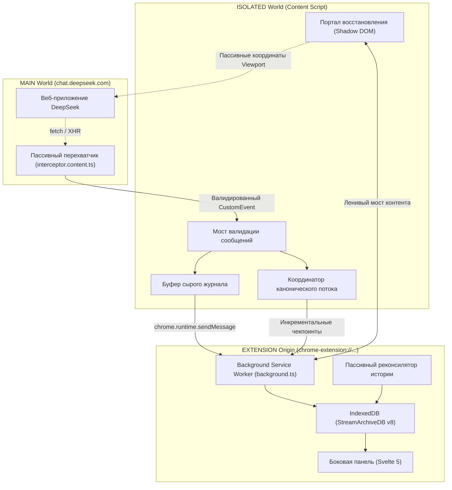

# DeepSeek StreamArchive

[English](./README.md) | **Русский**

> Локальное расширение для браузеров на базе Chromium, которое перехватывает и сохраняет ответы DeepSeek в реальном времени во время генерации, защищает от цензуры (`CONTENT_FILTER`) и обрывов сети, а также предоставляет удобный архив с поддержкой веток диалога в боковой панели (Side Panel).


---

## Обзор проекта

Современные веб-интерфейсы языковых моделей, такие как DeepSeek, передают сгенерированный текст токен за токеном по протоколу Server-Sent Events (SSE). В процессе генерации пользователи нередко сталкиваются с безвозвратной потерей ценных результатов:

```text
Пользователь отправляет запрос
        ↓
DeepSeek генерирует 2000+ токенов качественного кода или детального анализа
        ↓
Пользователь видит ответ в реальном времени и начинает его читать
        ↓
В конце срабатывает серверный фильтр безопасности:
        - status: "CONTENT_FILTER"
        - type: "TEMPLATE_RESPONSE"
        ↓
Веб-интерфейс DeepSeek удаляет весь полезный сгенерированный текст и подменяет его заглушкой:
"Извините, я не могу ответить на этот вопрос. Давайте поговорим о чём-нибудь другом."
        ↓
Сгенерированные 2000+ токенов удаляются навсегда как из памяти страницы, так и из истории на сервере.
```

Другие частые причины потери данных:
- Обрыв соединения или падение HTTP-потока в процессе ответа.
- Случайная перезагрузка или закрытие вкладки браузера во время генерации.
- Ошибки рендеринга виртуализированных списков на стороне интерфейса DeepSeek.
- Регенерация ответа, которая затирает предыдущую версию без возможности вернуться к ней.

**DeepSeek StreamArchive** полностью решает эти проблемы за счёт пассивного перехвата потоковых данных, многоуровневой избыточности и надёжного локального архивирования прямо в браузере.

---

## Ключевые возможности

### 1. Пассивный перехват без вмешательства в трафик
- **Неинвазивное наблюдение:** Клонирует и перехватывает исходящие потоковые ответы через `fetch()` и `XMLHttpRequest`, не задерживая оригинальный `Response` и не вмешиваясь в сетевой поток страницы.
- **Поддержка спецификации WHATWG SSE:** Корректная обработка произвольных границ чанков, многобайтовых символов UTF-8 и произвольной фрагментации потока.
- **Разделение уровней:** Транспортный декодер SSE полностью изолирован от прикладных протокольных JSON-патчей DeepSeek.

### 2. Защита от цензуры и отзыва ответов (Anti-Recall)
- **Барьер «Detect-Before-Apply»:** Перехватывает системные патчи `CONTENT_FILTER` и `TEMPLATE_RESPONSE` до того, как они успевают изменить внутреннее дерево состояния.
- **Сохранение лучшей версии (Last-Good):** Замораживает полный сгенерированный текст ответа и цепочку рассуждений в виде неизменяемой ревизии `isLastGood`.
- **События восстановления:** Сохраняет структурированные записи `RecoveryEvent`, связывающие факт цензуры с сохранённым исходным текстом.

### 3. Изолированное хранилище расширения
- **Изоляция origin Chromium MV3:** Все диалоги, сырые журналы и канонические модели сохраняются в IndexedDB, работающей исключительно в изолированном контексте расширения (`chrome-extension://<id>`).
- **Нулевой доступ со страницы:** Контекст веб-страницы (`chat.deepseek.com`) не имеет доступа к базе данных расширения, токенам и сохранённой переписке.

### 4. Отображение восстановленных ответов (Оверлей и опциональный режим Inline)
- **Нулевая модификация DOM (Режим оверлея):** По умолчанию не модифицирует элементы сообщений DeepSeek, сохраняя стабильность виртуализации React и верстки страницы.
- **Изолированный Closed Shadow DOM:** Отображает бейджи и карточки восстановления в закрытом `#shadow-root`, исключая утечки CSS и предотвращая чтение состояния скриптами страницы.
- **Опциональное отображение прямо в чате (Inline Mode):** Настраиваемый режим отображения (`overlay` или `inline`), встраивающий спасённый ответ прямо в блок сообщения ассистента через closed Shadow DOM с обратимым скрытием серверной заглушки, сворачиваемым блоком DeepThink и полным сохранением нативной панели кнопок DeepSeek (`Copy`, `Regenerate`, `Like`, `Dislike`, `Read aloud`, `Share`).
- **Конфиденциальная ленивая загрузка:** Первичные сводки не содержат фрагментов текста; полный восстановленный ответ загружается по защищенному IPC-мосту только по прямому клику пользователя или при inline-просмотре.
- **Изоляция маршрутов (Route Epoch Fencing):** Монотонные токены навигации гарантируют, что inline-блоки и бейджи предыдущей сессии мгновенно удаляются при переходе в другой диалог.

### 5. Архив в боковой панели (Svelte 5 Side Panel)
- **Нативный интерфейс Side Panel:** Быстрый и лёгкий интерфейс на базе Svelte 5 runes (`$state`, `$derived`, `$props`), расположенный рядом с открытым чатом.
- **Дерево диалога с поддержкой веток:** Переключатель веток (`Ветка X из Y`) для просмотра регенераций ответов и альтернативных веток после редактирования запросов.
- **Сворачиваемый блок DeepThink:** Отделяет цепочку рассуждений (`thinking`) от основного текста ответа, предотвращая визуальное загромождение.
- **История ревизий (Timeline Drawer):** Список всех зафиксированных версий ответа с индикацией источника (`network` или `history`), временными метками и отпечатками контента.
- **Карточка Recovery Preview:** Отображает исходный текст, сохранённый до вмешательства цензуры, с кнопкой мгновенного копирования в буфер обмена.
- **Безопасный рендеринг Markdown:** Токенизированный парсер заголовков, списков, цитат и блоков кода без использования `innerHTML` и `eval`.
- **Двуязычный интерфейс:** Полная поддержка английского и русского языков (`en` / `ru`).

### 6. Пассивная синхронизация с историей DeepSeek
- **Синхронизация без опроса:** Перехватывает ответы `/api/v0/chat/history_messages` при естественной навигации пользователя, связывая серверные идентификаторы (`message_id`, `chat_session_id`, `parent_id`) без фоновых запросов и без извлечения токенов авторизации.
- **Надёжное слияние идентичностей:** Серверные данные обновляют предварительные стриминговые записи по принципу `reconciled > provisional`, никогда не стирая доказательства цензуры.
- **Дедупликация и защита от циклов:** Идентичные дубликаты дедуплицируются, конфликтующие записи сервера отклоняются, а циклические связи родителей автоматически разрываются.

### 7. Надёжный журнал сырых данных (Raw Journal) и Replay
- **Хранение сырых байтов:** Фиксирует исходные чанки ответа в append-only журнал до их парсинга протокольным адаптером.
- **Монотонный контроль последовательности:** Ledger-реестр чекпоинтов отслеживает непрерывность передачи (`seq = lastCommitted + 1`) и отклоняет пропуски.
- **Защита от конфликтов в ревизиях:** Отклоняет попытки перезаписи ревизий другими данными при сохранении идемпотентности повторных запросов.
- **Детерминированное офлайн-воспроизведение:** Позволяет реконструировать каноническое дерево сообщений из сырых сохранённых чанков без подключения к сети.

### 8. 100% локально и конфиденциально
- **Никаких внешних серверов:** Ноль телеметрии, ноль аналитики, ноль облачных сервисов. Данные хранятся только на вашем компьютере.
- **Минимальные разрешения манифеста:** Расширение запрашивает только `storage` и `sidePanel`.

### 9. Экспорт, резервное копирование и атомарное восстановление (Этапы 2E.1 и 2E.2)
- **Экспорт диалогов для человека:** Выгрузка отдельных веток в чистый Markdown (`.md`) или канонический JSON (`.json`) с выбором активной ветки, сохранением рассуждений DeepThink и пометок о снятии цензуры.
- **Портативный бэкап всего архива:** Создание сжатого версионированного файла резервной копии (`.streamarchive.jsonl.gz`) через нативный `CompressionStream('gzip')` без сторонних библиотек и без разрешения `chrome.downloads`.
- **Безопасное атомарное восстановление:** Потоковая проверка архива с защитой от gzip-бомб (порог 250 МБ), валидация схем полей и предварительная проверка связности графа (ацикличность дерева, изоляция веток).
- **Два режима восстановления:** Поддержка режимов **Замена архива** (Replace Archive — атомарная замена в 1 транзакции по всем 9 таблицам со 100% гарантией отката) и **Безопасное объединение** (Merge Archive — объединение по первичным ключам с защитой от конфликтов и коллизий сессий).

### 10. Мониторинг хранилища, очистка и безопасное удаление (Этап 2E.3)
- **Наблюдаемость хранилища:** Измерение использования диска и квоты через `navigator.storage.estimate()` и точный подсчёт записей из IndexedDB.
- **Защита от вытеснения:** Запрос постоянного хранения (`navigator.storage.persist()`) в один клик для защиты архива при нехватке места на диске.
- **Настраиваемое хранение сырых данных:** Автоматическая очистка сырых HTTP-потоков по возрасту (`forever` [по умолчанию], 30, 90, 180 дней). Каноническая история диалогов **никогда** не удаляется автоматически.
- **Щит защищённых свидетельств (Protected Evidence Shield):** Активные потоки, спасённые версии ответов (`status === 'filtered'`, `RecoveryEvent`, `isLastGood`) и потоки с аномалиями защищены от удаления бессрочно.
- **Безопасное удаление отдельного диалога:** 2-этапное подтверждение с предпросмотром, барьером актуальности (`updatedAt`), проверкой активных потоков и атомарным каскадным откатом (`tx.abort()`).
- **Сервисные действия в настройках:** Быстрая ручная очистка устаревших потоков, удаление только сырых свидетельств с сохранением всех диалогов, либо полная очистка локального архива.
- **Локальная область действия:** Все операции выполняются строго внутри браузера и никоим образом не затрагивают аккаунт или историю на серверах DeepSeek.

---

## Архитектура системы

StreamArchive работает в трёх изолированных контекстах браузера:



---

## Структура хранилища IndexedDB (v8)

```text
IndexedDB: StreamArchiveDB (Версия 8)
├── Сырой журнал (Raw Journal)
│   ├── raw_streams: Метаданные потока, транспорт, статус целостности
│   └── raw_stream_batches: Сохранённые чанки с монотонной нумерацией
├── Реестр чекпоинтов
│   └── canonical_checkpoints: Прогресс сохранения потока и контроль разрывов
├── Стейджинг истории
│   ├── history_staging_manifests: Манифесты сессий для атомарной барьерной фиксации
│   └── history_staging: Инкрементальные батчи истории
└── Канонические сущности
    ├── conversations: Логические диалоги с привязкой к серверной сессии
    ├── messages: Узлы дерева сообщений с сохранением иерархии веток, ролей и projectionState
    ├── revisions: Неизменяемые ревизии текста и рассуждений с хеш-отпечатками
    └── recovery_events: Записи о фактах срабатывания цензуры и спасения текста
```

---

## Установка и сборка

### Требования
- [Node.js](https://nodejs.org/) >= 20.0.0
- [pnpm](https://pnpm.io/) >= 9.0.0

### Сборка проекта

1. Клонируйте репозиторий:
   ```bash
   git clone https://github.com/MalenkiySolovey/deepseek-stream-archive.git
   cd deepseek-stream-archive
   ```

2. Установите зависимости:
   ```bash
   pnpm install
   ```

3. Соберите расширение для production:
   ```bash
   pnpm run build
   ```
   Собранное расширение появится в каталоге `.output/chrome-mv3`.

### Запуск в Google Chrome / Chromium

1. Откройте страницу `chrome://extensions/`.
2. Включите **Режим разработчика** (Developer mode) в правом верхнем углу.
3. Нажмите кнопку **Загрузить распакованное** (Load unpacked) и выберите папку `.output/chrome-mv3`.
4. Перейдите на сайт [DeepSeek Chat](https://chat.deepseek.com/).
5. Откройте **Боковую панель** (Side Panel) в Chrome и выберите **DeepSeek StreamArchive** в выпадающем списке.

Инструкции по ручному тестированию на живом `chat.deepseek.com` и протокол см. в [Руководстве по приёмочному тестированию](./docs/LIVE_ACCEPTANCE.md) и [Отчёте о приёмочном тестировании (2026-11-02)](./docs/LIVE_ACCEPTANCE_RESULTS_2026-11-02.md).  
*Текущий статус проекта: Автоматическая синтетическая совместимость подтверждена; базовый уровень совместимости с живым интерфейсом принят 2026-11-02 (протестированный транспорт: XMLHttpRequest streaming).*

---

## Разработка и тестирование

Проект покрыт многоуровневым набором автоматических тестов (фаззинг границ чанков, декодирование протокола, перехват цензуры, миграции базы данных и браузерный стенд в headless Chromium MV3):

```bash
# Запуск полного набора юнит- и интеграционных тестов Vitest (70 файлов, 473 теста)
pnpm run test

# Проверка типов TypeScript
pnpm run typecheck

# Сборка распакованного расширения Chrome MV3
pnpm run build

# Запуск браузерного стенда совместимости Playwright (17 сценариев, 19 тестов, fail-closed изоляция)
pnpm run test:e2e

# Запуск dev-сервера WXT с горячей перезагрузкой
pnpm run dev
```

Подробную архитектуру стенда браузерной совместимости см. в [Документации стенда совместимости](./docs/COMPATIBILITY_HARNESS.md).

---

## Принципы безопасности и приватности

| Инвариант | Гарантия |
|---|---|
| **Никаких внешних запросов** | Расширение никогда не обращается к сторонним серверам, аналитике или облакам. |
| **Никакого активного опроса API** | Фоновый скрипт никогда не делает самостоятельных запросов к API DeepSeek. История обрабатывается только при естественной навигации в браузере. |
| **Никакого чтения учётных данных** | Расширение не читает `localStorage.userToken`, cookies сессии или заголовки `Authorization: Bearer`. |
| **Никакого перехвата запросов пользователя** | Текст исходящего запроса пользователя не инспектируется. |
| **Безопасный рендеринг** | Вывод форматируется через токенизацию; использование `innerHTML`, `{@html}` и `eval` строго запрещено. |
| **Изоляция хранилища** | База данных открывается только в origin расширения (`chrome-extension://<id>`). |

---

## Использованные наработки сторонних проектов

- **[EdgeTypE/better-deepseek](https://github.com/EdgeTypE/better-deepseek)** (лицензия MIT):
  Адаптирована логика рекурсивного поиска идентификатора сообщения в потоковом ответе (`src/adapters/deepseek/protocol/message-id.ts`).

---

## Лицензия

Проект распространяется под лицензией [MIT License](./LICENSE).
