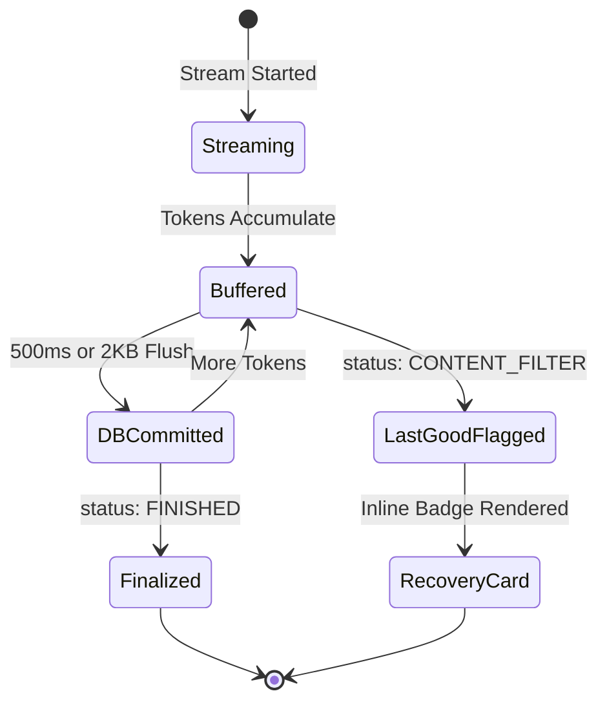

# Architecture Reference Manual

> **DeepSeek StreamArchive**  
> Status: Authoritative Architecture Specification  
> Target: Core Developers, Maintainers, and Contributors  
> Target Platform: Chromium (Manifest V3) / Planned: Firefox  

---

## 1. Problem Statement

Modern conversational AI web applications like DeepSeek stream answers token-by-token over Server-Sent Events (SSE). During this process, several common failure scenarios cause users to permanently lose valuable generated output:

```text
User submits prompt
        ↓
DeepSeek streams 2,000 tokens of high-quality code or analysis
        ↓
User reads and relies on the answer in real time
        ↓
DeepSeek's post-generation safety filter triggers:
        - status: "CONTENT_FILTER"
        - type: "TEMPLATE_RESPONSE"
        ↓
The DeepSeek web frontend replaces the entire useful message with:
"Sorry, I cannot answer this question. Let's talk about something else."
        ↓
The generated 2,000 tokens are permanently discarded on both frontend and server.
```

Other frequent loss vectors include:
- Network dropouts / broken HTTP streams midway through generation.
- Accidental browser tab reload or closure.
- DeepSeek frontend bugs or virtual list DOM re-rendering glitches.
- Regenerating a turn without an easy way to view the prior attempt.

Existing solutions either depend purely on fragile DOM scraping (e.g. `fireflyhoo`), rewrite server network streams in-flight (e.g. `CATIOR`), or lack real-time stream capture entirely (e.g. `headroom`). StreamArchive solves this comprehensively through passive streaming capture, multi-source redundancy, and durable local archiving.

---

## 2. Goals

1. **Never Lose a Response:** Preserve every token that successfully reaches the browser before any client-side replacement or network interruption occurs.
2. **Passive Capture First:** Default to read-only observation; never tamper with live network responses or user prompts as a baseline requirement.
3. **Multi-Source Redundancy:** Combine real-time network streaming (Primary), History API reconciliation (Secondary), and DOM extraction (Tertiary).
4. **Canonical Identity & Revision Journal:** Maintain a true append-only revision journal for every message, preserving intermediate drafts, thinking traces, and "last-good" responses.
5. **Extension-Isolated Persistence:** Store conversations locally in an IndexedDB database secured within the extension origin (`chrome-extension://<id>`).
6. **Non-Destructive Recovery:** Present recovered responses via isolated inline cards (Shadow DOM) and an Extension Side Panel without mutating living React/Vue DOM elements.
7. **Resilient Compatibility Layer:** Isolate volatile DeepSeek endpoints, selectors, and status markers inside versioned compatibility profiles. Expose system health via a runtime capability probe.
8. **100% Local & Private:** Zero external servers, zero cloud accounts, zero telemetry, zero credential logging.

---

## 3. Non-Goals

StreamArchive explicitly rejects the following to prevent scope creep:
- **No Generic AI Customization Suite:** We do not build text-to-speech, web scrapers, document editors, or prompt marketplaces.
- **No Cloud Synchronization Service:** All data remains on the local disk. No centralized user accounts or cloud databases.
- **No Bypass Proxy or VPN:** We do not route traffic through unblocking servers or third-party re-writing proxies.
- **No Active Prompt Modification by Default:** We do not inject hidden prefixes into outgoing prompts (shadow context) by default.
- **No Premature Multi-Platform Scope:** v0.x focuses exclusively on DeepSeek. Core contracts allow future adapters, but no unverified code for other LLMs will be written today.
- **No Premature WebSocket Implementation:** We design transport interfaces to allow WebSockets in the future, but will not implement WebSocket decoders until DeepSeek deploys them.

---

## 4. High-Level Architecture

StreamArchive is structured into four distinct horizontal tiers and three browser execution realms:

```mermaid
flowchart TD
    subgraph PAGE_MAIN_WORLD["MAIN World (chat.deepseek.com)"]
        PageApp["DeepSeek Web Application"]
        Interceptor["Minimal Interceptor (interceptor.main.ts)"]
        PageApp -.->|fetch / XHR| Interceptor
    end

    subgraph ISOLATED_WORLD["ISOLATED Content Script"]
        Bridge["Bridge Receiver & Schema Validator"]
        RecorderBuffer["In-Memory Revision Buffer"]
        InlineUI["Non-Destructive Overlay UI"]
        Interceptor -->|CustomEvent (Validated)| Bridge
        Bridge --> RecorderBuffer
        Bridge --> InlineUI
    end

    subgraph EXTENSION_WORLD["Extension Origin (chrome-extension://...)"]
        BackgroundWorker["Background Service Worker (background.ts)"]
        SidePanel["Extension Side Panel (Svelte 5)"]
        StorageEngine["IndexedDB (StreamArchiveDB)"]
        Reconciler["History Reconciler"]
        
        RecorderBuffer -->|chrome.runtime.sendMessage| BackgroundWorker
        BackgroundWorker --> StorageEngine
        Reconciler --> StorageEngine
        StorageEngine --> SidePanel
    end
```

---

## 5. End-to-End Data Flow

```text
1. Network Generation:
   fetch() or XMLHttpRequest (text/event-stream candidate)
       │
2. Passive Transport Tap (MAIN world):
   - window.fetch: Clones response synchronously, returns original Response immediately to page, drains cloned body asynchronously.
   - XMLHttpRequest: Incremental responseText offset slicing on progress/readystatechange.
   - Utf8StreamDecoder: Decodes multi-byte Unicode chunks, handles BOM.
   - Emits TransportEvent (open, chunk, complete, abort/error) across CustomEvent bridge.
       │
3. Runtime-Validated Bridge (ISOLATED world):
   - Validates envelope and transport payload schema (producerSessionId, sequence, streamSequence, streamId).
   - Hosts page-lifetime stream decoders (GenericSseDecoder & DeepSeekProtocolDecoder - see ADR 0008).
       │
4. Generic SSE Engine (ISOLATED content script):
   - GenericSseDecoder parses standard SSE event stream (LF/CRLF/CR, comments, id, retry, multiline data).
   - Incomplete EOF data without trailing blank line is discarded per WHATWG spec.
   - Emits clean, framed SseEvent objects.
       │
──────────── PLATFORM BOUNDARY ────────────
       │
5. DeepSeek Protocol Adapter (ISOLATED content script):
   - Consumes framed SseEvent objects.
   - Executes detect-before-apply guard to freeze pre-mutation lastGood state on CONTENT_FILTER / TEMPLATE_RESPONSE.
   - Safe recursive patch applier (SET, APPEND, REPLACE, BATCH, negative indexes, inherited p/o).
   - Projects fragments into separated answer and thinking texts with semantic diffing.
   - Extracts message ID (search depth <= 5, later ID wins) and route session ID.
   - Emits batched DeepSeekSemanticEvent objects to Background Service Worker via chrome.runtime.sendMessage.
       │
6. Revision Journal & Storage (Extension Origin):
   - Background coordinates diagnostics and commits revisions to IndexedDB (conversations, messages, revisions).
   - Resolves writes strictly upon transaction commit.
```

---

## 6. Capture Source Hierarchy

StreamArchive operates a three-tier capture redundancy model:

```text
Priority 1: Real-Time Network Streaming Capture
             ↓ (reconciles with)
Priority 2: DeepSeek History API Reconciliation
             ↓ (falls back to if unavailable)
Priority 3: DOM Fallback Extraction
```

1. **Source A: Network Streaming (Primary):** Observes raw SSE tokens as they arrive. Captures transient text before client-side replacement or network drops occur.
2. **Source B: History API (Secondary / Authoritative for Identity):** Intercepts or passively queries `/api/v0/chat/history_messages`. Provides stable `message_id`, `chat_session_id`, and `parent_id` relationships.
3. **Source C: DOM Fallback (Tertiary / Last Resort):** Evaluates rendered page content via confidence-scored selectors when network capture is impaired.

---

## 7. Trust & Security Boundaries

```text
┌─────────────────────────────────────────────────────────────┐
│ UNTRUSTED: DeepSeek Page (MAIN World)                       │
│ - Zero access to extension storage.                         │
│ - Minimal interceptor has zero privileges.                 │
└──────────────────────────────┬──────────────────────────────┘
                               │ Strict Schema Validation
                               ▼
┌─────────────────────────────────────────────────────────────┐
│ CONTROLLED: Isolated Content Script                         │
│ - Validates all incoming bridge messages.                   │
│ - Never opens IndexedDB under page origin.                  │
└──────────────────────────────┬──────────────────────────────┘
                               │ chrome.runtime.sendMessage
                               ▼
┌─────────────────────────────────────────────────────────────┐
│ PRIVILEGED: Extension Origin (Service Worker & Side Panel)  │
│ - Hosts StreamArchiveDB (IndexedDB).                        │
│ - Completely isolated from chat.deepseek.com.               │
└─────────────────────────────────────────────────────────────┘
```

---

## 8. Core vs DeepSeek Adapter Boundary

To prevent code decay, DeepSeek-specific knowledge is quarantined:

| Capability | Core Responsibilities (`src/core/`) | DeepSeek Adapter (`src/adapters/deepseek/`) |
|---|---|---|
| **Domain Logic** | Manages `Conversation`, `Message`, `Revision` lifecycles. | Maps DeepSeek payload keys into domain events. |
| **DOM Knowledge** | ZERO DOM queries. Never queries `.ds-markdown`. | Houses selector tables and fallback parsers. |
| **Protocol** | Operates on generic `StreamDelta` and `FilterEvent`. | Decodes DeepSeek JSON-patches (`p`, `o`, `v`, `BATCH`). |
| **Endpoints** | Has no knowledge of API URLs. | Catalogs DeepSeek chat and history endpoints. |

---

## 9. Transport vs Protocol Layering

```text
transport/ (Generic)
  - fetch-observer.ts
  - xhr-observer.ts
  - sse-decoder.ts
  - websocket/ (future)
        ↓ Emits: ServerSentEvent { event, data }
adapters/deepseek/protocol/ (Vendor Specific)
  - stream-decoder.ts
  - fragments.ts
  - operations.ts (APPEND, SET, REPLACE, BATCH, -1 index)
  - statuses.ts (CONTENT_FILTER, TEMPLATE_RESPONSE)
        ↓ Emits: Canonical Domain Events
core/recorder/
```

Generic transport code has **zero knowledge** of DeepSeek semantics.

---

## 10. Canonical Domain Model

```ts
export type CaptureSource = 'network' | 'history' | 'dom' | 'replay';

export interface Conversation {
  id: string;              // Local stable UUID
  remoteId?: string;        // DeepSeek chat_session_id
  title: string;           // Title (from document.title or history)
  createdAt: number;
  updatedAt: number;
}

export interface Message {
  id: string;              // Local stable UUID
  remoteId?: string;        // DeepSeek message_id
  conversationId: string;
  parentId?: string;       // Local parent UUID
  remoteParentId?: string; // DeepSeek parent_message_id (User prompt)
  sourceRawStreamKey?: string; // Foreign key to RawStreamRecord
  identityState: 'provisional' | 'reconciled'; // Live stream turns start provisional, upgrade upon history
  role: 'user' | 'assistant' | 'system' | 'unknown';
  status: 'streaming' | 'finished' | 'filtered' | 'incomplete' | 'timeout' | 'context_length_exceeded' | 'interrupted' | 'degraded' | 'unknown';
  content?: string;        // Preserved text for user prompts
  createdAt: number;
  updatedAt: number;
}

export interface ResponseRevision {
  id: string;
  messageId: string;
  revisionIndex: number;   // Monotonic: 0, 1, 2, 3...
  text: string;            // Assistant response text
  thinking?: string;       // DeepThink reasoning text (separated)
  source: CaptureSource;
  capturedAt: number;
  isFinal: boolean;
  isLastGood: boolean;     // True if best pre-filtered state
  contentFingerprint?: string; // Deterministic content fingerprint (fp_<len>_<hash>)
}

export interface RecoveryEvent {
  id: string;
  messageId: string;
  kind: 'content_filter' | 'template_response' | 'network_interruption' | 'dom_replacement' | 'synthetic';
  detectedAt: number;
  recoveredRevisionId: string;
  reason?: string;
}
```

---

## 11. Persistence Architecture

### Dual Storage Strategy
1. **`chrome.storage.local`:** User settings, active compatibility profile, UI state, retention limits.
2. **`IndexedDB` (`StreamArchiveDB`, Version 5):**
   - **V1 Stores:** `conversations`, `messages`, `revisions`, `recovery_events`.
   - **V2 Raw Journal Stores:**
     - `raw_streams`: Tracks stream sessions (`id`, `transport`, `url`, `provisionalSessionId`, `state`, `openedAt`, `updatedAt`, `totalChunks`, `totalChars`, `totalBatches`).
     - `raw_stream_batches`: Persists chunks in deterministic batches (`id = ${streamKey}:${batchSeq}`).
   - **V3 Indexing:** Compound index `conversationId_remoteId` (`['conversationId', 'remoteId']`) on `messages`.
   - **V4 Indexing & Atomicity:** Dedicated `identityState` index on `messages`. Single-transaction atomic writes via `saveCanonicalCheckpoint` and `applyHistoryReconciliationPlan`.
   - **V5 Checkpoint Ledger & Archive Queries:**
     - `canonical_checkpoints`: Tracks live stream checkpoint progression (`streamKey`, index `updatedAt`). Enforces `seq === 0` initial, monotonic `seq === lastCommitted + 1`, idempotent re-ACK on `seq === lastCommitted`, and gap rejection (`checkpoint_sequence_gap`).
     - Immutable revision and recovery event payload conflict rejection (`revision_conflict`, `recovery_event_conflict`).
     - Single atomic transaction for raw journal replay promotion via `applyReplayPromotionPlan`.
     - Metadata-first query architecture (`listArchiveConversations`, `getArchiveConversation`, `listArchiveMessages`, `getRevisionContent`) enabling fast, scalable rendering in the Side Panel.
   - Hosted strictly within extension origin (`chrome-extension://<id>`).
   - Multi-factory database connection management with `WeakMap` cache and `onversionchange` handlers.

### Durable Raw Journaling & Crash-Durability Architecture
- Raw response text is buffered via `RawJournalBuffer` on the content script side *prior* to or parallel with protocol decoding to preserve forensic evidence.
- **Strict Monotonic Ordered Pipeline:** Enforces sequential delivery across the bridge:
  `OPEN ACK -> BATCH 1 ACK -> BATCH 2 ACK -> ... -> FINAL BATCH ACK -> FINALIZE ACK`.
- **Strict In-Flight ACK Binding:** Content scripts validate that incoming ACKs match the active in-flight request identity (`streamKey`, `batchSeq`, `finalState`). Mismatched or unsolicited ACKs are rejected and keep the pending queue intact.
- **Strict Monotonic Sequences & Gaps:** Repository enforces `batchSeq === 1` for initial batches and `batchSeq === (lastPersistedBatchSeq || 0) + 1` for subsequent batches, rejecting out-of-order batches with `batch_sequence_gap`. Sequence gaps over the wire are forensically committed while permanently tagging the stream with `integrity: 'gap_detected'` and `state: 'degraded'`.
- **Natural Storage Order Replay (Replay Truth):** Chunks are replayed strictly in their persisted storage order without synthetic sorting. `replayRawStream` and `replayRawBatches` produce a detailed `ReplayAuditReport` flagging non-contiguous sequences, gaps, duplicate keys, or missing prefixes.
- **Zero Synthetic Stream Fabrication:** Repository rejects unopened batches and late finalizations with typed error `stream_not_open`, eliminating stub metadata. Duplicate opens with conflicting URLs or transports reject with `stream_identity_conflict`.
- **Payload-Aware Batch Idempotency:** Duplicate batch deliveries verify payload equality; identical payloads return idempotent ACKs, while conflicting payloads reject with `batch_id_conflict` and mark the stream degraded.
- **Idempotent Finalization with Conflict Rejection:** Retried finalize requests return the original `finalizedAt` without re-accumulating `droppedChars` or modifying committed state. Conflicting terminal requests reject with `finalize_conflict`.
- **Finalization Barrier:** Terminal events (`complete`, `abort`, `error`) seal buffered chunks into a final batch and await all prior batch ACKs before dispatching `STREAMARCHIVE_FINALIZE_RAW_STREAM`. Buffer memory is evicted only after authoritative `FINALIZE ACK`.
- **Unload Hooks & Persistent Storage:** `visibilitychange` and `pagehide` listeners provide best-effort buffer flushes upon tab backgrounding or navigation. Best-effort `navigator.storage.persist()` is requested.
- **Hard Pre-Append Memory Ceiling & Host Anti-Spoofing:** Active streams bound to 16. Total pending characters capped at 512 KiB evaluated *before* appending new chunks; excess chunks are dropped with exact `droppedChars` tracking and `durabilityGap` flags. Host anti-spoofing enforces `chat.deepseek.com` origin checks, and field validation forbids `:` in stream IDs.
- **Strict Durability Hint:** `createRawWriteTransaction` requests `strict` durability hint with fallback.
- **Scalable Queries:** `listStreams` uses cursor traversal on `openedAt` index (`'prev'`); `getJournalMetadata()` queries exclusively from `raw_streams` records and incorporates storage quota estimates.


---

## 12. Revision Lifecycle



---

## 13. Multi-Source Reconciliation

When both real-time stream data and history API data exist:
1. **Identity Pairing:** Assistant messages are paired to User prompts by `parent_id`.
2. **Conflict Resolution:**
   - If history reports `status: "CONTENT_FILTER"`, the streaming recorder's `LastGoodRevision` is preserved as the active display text.
   - If history provides full server text for turns missed by the stream recorder, history fills the gap.
3. **Tail Alignment for DOM Fallback:** When aligning virtualized DOM to API data, StreamArchive utilizes the `ai-chat-exporter` algorithm (matching stable IDs first, normalized text second, and tail-window offset fourth).

---

## 14. Non-Destructive Recovery UI

1. **Inline Recovery Badge (Shadow DOM):**
   Rendered adjacent to an affected turn:
   ```text
   ┌─────────────────────────────────────────────────────────────┐
   │ ⚠ DeepSeek replaced this response                           │
   │ Local copy preserved: 4,817 chars (Streaming capture)       │
   │ [View Inline]  [Copy Markdown]  [Open in Side Panel]        │
   └─────────────────────────────────────────────────────────────┘
   ```
   Zero direct mutation of `el.innerHTML`.
2. **Extension Side Panel Read-Only Archive Browser:**
   Primary local archive interface implemented with Svelte 5 runes (`$state`, `$derived`, `$props`):
   - **Conversation Navigation:** Filterable list of archived conversations sorted chronologically (`updatedAt` descending) with cursor-based pagination and search.
   - **Conversation Thread View:** Full message history with branch switcher (`Branch X of Y`) for regenerated and edited turns, non-destructive status indicators, and pre-filter Recovery Preview cards.
   - **Thinking Separation:** Collapsible reasoning box for DeepThink traces (`thinking`), isolated from final answer text.
   - **Revision Timeline Drawer:** Chronological drawer listing each revision (`revisionIndex`, capture source, timestamp, fingerprint) with single-click clipboard copying.
   - **Safe Markdown Rendering:** Token-based parser rendering code blocks, inline code, and text safely with zero `innerHTML` and zero `eval`.
   - **Multi-language UI:** Full internationalization (`en` and `ru`).
   - **Zero DOM Pollution:** Completely contained within extension origin (`chrome-extension://<id>/sidepanel.html`); zero scripts or elements injected into `chat.deepseek.com`.

---

## 15. Compatibility & Degraded Modes

StreamArchive defines explicit degraded states:
- **Degraded Mode A (Stream Format Unknown):** Raw stream logged to `raw_events`; turns backed up via History API + DOM fallback.
- **Degraded Mode B (CSS Classes Rehashed):** Inline badge switches to viewport docking; Side Panel and stream capture operate at 100%.
- **Degraded Mode C (History API Down):** 100% reliant on real-time stream capture and local UUID tracking.

---

## 16. Testing Strategy Reference

See [TESTING_STRATEGY.md](./TESTING_STRATEGY.md) for complete specifications:
- Deterministic SSE chunk-boundary fuzzing (1 byte, 2 bytes, UTF-8 splits).
- Regression fixture corpus across all DeepSeek failure categories.
- Fake-indexeddb transaction resilience tests.

---

## 17. Extension Runtime Boundaries

```text
Manifest V3 Specification:
- entrypoints/
  - background.ts (Service Worker)
  - content.ts (ISOLATED World)
  - interceptor.main.ts (MAIN World)
  - sidepanel/ (Extension HTML page + Svelte 5)
```

---

## 18. Future Extension Points

1. **WebSocket Transport:** Pluggable under `src/transport/websocket/` without altering core or storage.
2. **Additional LLM Adapters:** Pluggable under `src/adapters/<vendor>/` without altering core revision engine.
3. **Offline Replay Utility:** Re-evaluating historical raw streams against newer protocol decoders.

---

## 19. Known Unknowns

1. **Future Authentication Schemes:** If DeepSeek switches to encrypted or binary WebSocket streams, passive HTTP interception will require updated reverse-engineering.
2. **Server-Side Token Dropping:** If DeepSeek filters responses upstream before sending *any* bytes to the browser, client-side capture cannot observe the missing text.

---

## 20. Architectural Scope Boundaries

### Core Capabilities:
- **Passive Transport Capture:** Fetch & XHR passive interception, WHATWG SSE Framing, UTF-8 decoders.
- **DeepSeek Protocol Adapter:** JSON Patch applier, fragment projection, detect-before-apply censorship guard, message ID extraction.
- **Protocol Hardening:** Monotonic sequence integrity, orphan chunk rejection, disambiguated terminal semantics, Dual Shape support.
- **SSE Control Plane:** DeepSeek SSE control event plane, status authority decoupling, anti-recall race condition resolution.
- **Durable Raw Journal:** Raw streams/batches IndexedDB persistence, transactional ACK pipeline, crash durability, storage persistence.
- **Canonical Model & Passive History Reconciliation:** Canonical domain model (Conversation, Message, ResponseRevision, RecoveryEvent), last-good anti-recall invariant, pure passive history observation, two-pass parent resolution preserving sibling branches.
- **Side Panel Archive Browser:** Svelte 5 runes UI, conversation list with search and pagination, branch switcher, collapsible thinking process, revision timeline drawer, safe Markdown rendering.

### Scope Boundaries:
1. **Zero DOM Pollution by Default:** Clean passive observation without modifying page responses.
2. **Zero Active Background Fetches:** No proactive background requests to DeepSeek APIs (history capture remains strictly passive observation).
3. **Zero Token / Bearer Inspection:** No reading `localStorage.userToken` or Authorization request headers.
4. **Zero Prompt Request Body Inspection:** Outgoing user prompt payloads remain uninspected.
