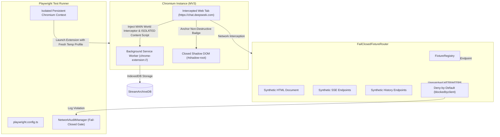

# DeepSeek StreamArchive — Browser Compatibility Harness

## 1. Overview

DeepSeek StreamArchive is a Manifest V3 (MV3) Chromium browser extension designed to capture streaming responses, withstand server-side content filter replacement, and provide a durable side panel archive.

Because MV3 extensions rely heavily on browser-specific execution contexts—Background Service Workers, Content Scripts in isolated worlds, Main World interceptors, and closed Shadow DOM portals—standard Node-based unit and mock tests cannot fully validate browser runtime boundaries.

The **Browser Compatibility Harness** executes end-to-end regression suites in a real Chromium browser instance powered by [Playwright](https://playwright.dev/).

---

## 2. Fail-Closed Network Isolation Guarantee

> [!IMPORTANT]
> **Strict Fail-Closed Policy: Zero External Network Egress**  
> All HTTP and HTTPS traffic in browser tests is intercepted by `FailClosedFixtureRouter`.  
> - **Default Policy:** `DENY BY DEFAULT`. Any request to an external server or unregistered endpoint is immediately aborted with `blockedbyclient` and recorded in `NetworkAuditManager`.
> - **Zero Credentials:** Tests never send cookies, authentication tokens, API keys, or session identifiers to any external server.
> - **Zero Synthetic Pass-Through:** `route.continue()` is forbidden for HTTP/HTTPS requests. Only internal browser protocols (`chrome-extension://`, `data:`, `blob:`) are permitted.
> - **Post-Test Audit:** Every test asserts `router.audit.assertClean()`, failing immediately if any unhandled external request occurred.

---

## 3. Harness Architecture



### Key Mechanisms:
1. **Profile Isolation:**  
   Every test execution creates a unique, isolated temporary user data directory (`fs.mkdtempSync`), ensuring zero cross-test IndexedDB or cache pollution.
2. **Deterministic Protocol Fixtures:**  
   The synthetic router fulfills DeepSeek's exact Server-Sent Events (SSE) format, including:
   - Chunk fragmentation across UTF-8 multi-byte code points.
   - DeepSeek protocol envelopes (`v0`, `biz_data`, `session_id`, `message_id`).
   - Content filter replacement events (`status: "CONTENT_FILTER"`, `type: "TEMPLATE_RESPONSE"`).
   - Server history payloads in both `fragments[]` and `content + thinking_content` flat fields shapes.
3. **Background Worker Inspection:**  
   Tests query extension storage and internal state by evaluating directly inside the extension's background service worker (`chrome-extension://` origin) or sidepanel context, inspecting IndexedDB (`StreamArchiveDB`) directly.

---

## 4. What Browser E2E Proves vs. Unit Tests

| Testing Dimension | Unit & Integration Tests (Vitest) | Browser Compatibility Harness (Playwright) |
|---|---|---|
| **Execution Environment** | Node.js + Happy-DOM / FakeIndexedDB | Real Headless Chromium MV3 Instance |
| **World Isolation** | Simulated in memory | Real Chrome `MAIN` vs `ISOLATED` world boundaries |
| **Network Hooks** | Monkey-patched globals in JSDOM | Native `window.fetch` and `XMLHttpRequest` interception |
| **Shadow DOM Encapsulation** | Mock element tree | Closed ShadowRoot attachment and light-DOM immunity |
| **SPA Navigation** | Synthetic popstate event dispatch | Real browser `window.history.pushState` and `navigation` API |
| **MV3 Service Worker Lifecycle** | Direct class instantiation | Service worker registration, message port dispatch, runtime epochs |
| **Payload Coverage** | Edge cases, parser fuzzing, schema benchmarks | End-to-end delivery from DOM hook to IndexedDB |

### Synthetic Fixture Limitations:
- The compatibility harness uses synthetic DOM layouts and mock API responses. While the schema and stream structure match verified DeepSeek behavior, UI layout styling, React Fiber internals, and server-side timing variations are not simulated.
- **Manual live verification on `https://chat.deepseek.com` remains mandatory** before production release to validate live authentication, anti-bot protections, and real-time frontend framework updates.

---

## 5. Test Specifications

The harness currently comprises 8 automated test specifications in `tests/browser/` (9 test cases):

| Specification File | Focus Area | Verification Invariants |
|---|---|---|
| `normal-generation.spec.ts` | Standard Fetch Generation | Monotonic checkpoints, non-invasive capture, correct title and message indexing in IndexedDB, concrete pipeline verification chain assertion (`bg_reachable`, `main_interceptor`, `bridge_handshake`, `fetch_hook`, `generation_candidate`, `raw_chunk_observed`, `raw_journal_ack`, `canonical_checkpoint_ack`). |
| `xhr-generation.spec.ts` | XMLHttpRequest Generation | Captures streaming responses initiated via `XMLHttpRequest`, commits raw journal batches, records canonical revisions, asserts active `xhr_hook`. |
| `filter-replacement.spec.ts` | Content Censorship Recovery | Preserves pre-filter `lastGood` revision, creates authoritative `RecoveryEvent`, ensures host DOM container remains intact. |
| `history-reconciliation.spec.ts` | History API Ingest (Dual Shape) | Ingests and reconciles history messages in both `fragments[]` shape and `content + thinking_content` flat fields shape. |
| `mv3-service-worker-lifecycle.spec.ts` | MV3 Lifecycle & Runtime Epochs | Validates that durable archive evidence survives across service worker epochs while current runtime diagnostics isolate to the active epoch. |
| `network-interruption.spec.ts` | Client Abort & Stream Interruption | Handles mid-stream consumer abort gracefully, retaining partial stream revisions as `partial_capture` without claiming `pre_filter_recovery`. |
| `degradation-profile.spec.ts` | Unknown Protocol Shapes | Preserves raw stream journal when encountering unknown SSE protocol shapes without crashing or disrupting the page. |
| `route-isolation.spec.ts` | SPA Navigation & Route Isolation | Immediate pre-revocation of session state upon client-side `pushState` navigation without artificial popstate events, preventing cross-conversation leakage. |

---

## 6. Running the Harness

### Prerequisites
Build the production extension bundle before executing the harness:
```bash
cd workbench
pnpm run build
```

Ensure Playwright Chromium is installed:
```bash
pnpm exec playwright install chromium --with-deps
```

### Running All Browser Tests
```bash
pnpm run test:e2e
```

### Running a Specific Test
```bash
pnpm exec playwright test tests/browser/normal-generation.spec.ts
```

---

## 7. Continuous Integration (CI)

The browser compatibility harness runs automatically in GitHub Actions on every pull request and push to `main` (`.github/workflows/ci.yml`).

All browser specifications must pass with zero network violations for the build to succeed.
