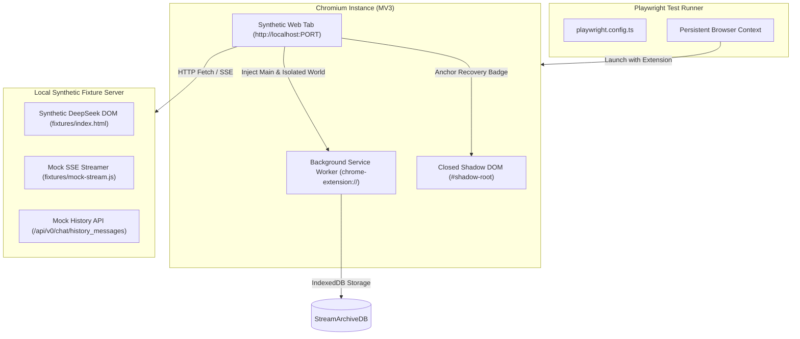

# DeepSeek StreamArchive — Browser Compatibility Harness

## 1. Overview

DeepSeek StreamArchive is a Manifest V3 (MV3) Chromium browser extension designed to capture streaming responses, withstand server-side content filter replacement, and provide a durable side panel archive.

Because MV3 extensions rely heavily on browser-specific execution contexts—Background Service Workers, Content Scripts in isolated worlds, Main World interceptors, and closed Shadow DOM portals—standard Node-based unit and mock tests cannot fully validate browser runtime boundaries.

The **Browser Compatibility Harness** executes end-to-end regression suites in a real Chromium browser instance powered by [Playwright](https://playwright.dev/).

---

## 2. Zero External Network Guarantee

> [!IMPORTANT]
> **Strictly Local Synthetic Fixtures — Zero External Network Access**  
> The compatibility harness executes against an internal HTTP server that serves synthetic DeepSeek HTML and protocol streams (`fixtures/index.html`, `fixtures/api-stream.js`).  
> At no point does the harness connect to `https://chat.deepseek.com`, send telemetry, or contact third-party servers. All tests are completely deterministic, air-gap safe, and safe for continuous integration (CI) runners.

---

## 3. Harness Architecture



### Key Mechanisms:
1. **Unpacked Extension Loading:**  
   Playwright launches a persistent Chromium context with:
   ```ts
   args: [
     `--disable-extensions-except=${pathToExtension}`,
     `--load-extension=${pathToExtension}`,
     '--headless=new',
   ],
   ignoreDefaultArgs: ['--disable-extensions']
   ```
2. **Deterministic Protocol Fixtures:**  
   The synthetic server reproduces DeepSeek's exact Server-Sent Events (SSE) format, including:
   - Chunk fragmentation across UTF-8 multi-byte code points.
   - DeepSeek protocol envelopes (`v0`, `biz_data`, `session_id`, `message_id`).
   - Content filter replacement events (`status: "CONTENT_FILTER"`, `type: "TEMPLATE_RESPONSE"`).
   - Server history payloads with multi-batch pagination.
3. **Background Worker Inspection:**  
   Tests query extension storage and internal state by evaluating directly inside the extension's background service worker (`context.serviceWorkers()`), avoiding cross-origin permission restrictions.

---

## 4. Test Specifications

The harness currently comprises 6 automated test specifications in `tests/browser/`:

| Specification File | Focus Area | Verification Invariants |
|---|---|---|
| `normal-generation.spec.ts` | Standard Generation | Monotonic checkpoints, non-invasive capture, correct title and message indexing in IndexedDB. |
| `filter-replacement.spec.ts` | Content Censorship Recovery | Pre-filter `lastGood` revision frozen, zero host DOM mutation, recovery badge rendered in closed shadow root, clipboard copy. |
| `history-reconciliation.spec.ts` | Passive History Ingest | Staged multi-batch ingest, manifest validation, atomic commit, provisional ID to server UUID resolution, preservation of live revisions. |
| `route-isolation.spec.ts` | SPA Navigation & Route Race | Route epoch invalidation, instant cleanup of prior chat badges, zero cross-session recovery leakage. |
| `network-interruption.spec.ts` | Abort & Disconnect Handling | Graceful abort detection, crash-durable persistence of partial streaming tokens with `network_error`. |
| `degradation-profile.spec.ts` | Performance Under Load | High-frequency chunk throughput (100+ tokens/sec), memory stability, low main-thread blocking overhead. |

---

## 5. Running the Harness

### Prerequisites
Build the production extension bundle before executing the harness:
```bash
cd workbench
pnpm run build
```

Ensure Playwright Chromium is installed:
```bash
pnpm exec playwright install chromium --with-deps
```

### Running All Browser Tests
```bash
pnpm run test:e2e
```

### Running a Specific Test with DevTools / UI
```bash
pnpm exec playwright test tests/browser/filter-replacement.spec.ts --headed
```

---

## 6. Continuous Integration (CI)

The browser compatibility harness runs automatically in GitHub Actions on every pull request and push to `main` (`.github/workflows/ci.yml`).

The CI workflow:
1. Installs Node.js and pnpm dependencies.
2. Runs Vitest unit and mock integration tests (`pnpm run test`).
3. Runs TypeScript typecheck (`pnpm run typecheck`).
4. Builds the unpacked extension bundle (`pnpm run build`).
5. Installs Playwright Chromium browser binaries.
6. Executes `pnpm run test:e2e` in headless mode.

All 6 browser specifications must pass for the build to succeed.
